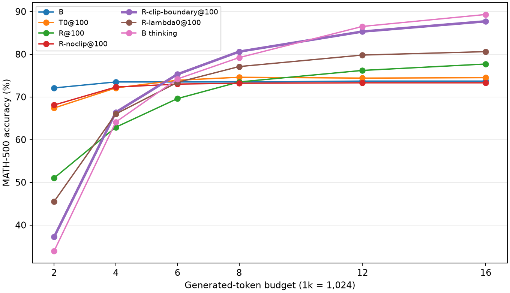

# MATH-500 回答中的结束标签与预算曲线

非思考独立评测为 4k 每题四条、16k 每题两条。按生成文本里是否出现字面量 `</think>` 分组，长度为归档生成 token 数。空分层记 NA。

|预算|模型|出现率|含标签 条数 / 准确率 / 平均长度|无标签 条数 / 准确率 / 平均长度|
|---|---|---:|---:|---:|
|4096|B|0.00%|0 / NA / NA|2000 / 73.20% / 869.5|
|4096|T0@100|0.00%|0 / NA / NA|2000 / 69.85% / 1433.3|
|4096|R@100|15.15%|303 / 95.71% / 2678.5|1697 / 57.34% / 1951.5|
|4096|R-noclip@100|90.50%|1810 / 72.43% / 1105.0|190 / 71.58% / 1073.2|
|4096|R-cond@100|缺独立归档|—|—|
|4096|R-clip-boundary@100|54.65%|1093 / 97.62% / 2735.3|907 / 33.19% / 2874.7|
|4096|R-clip-interior@100|54.60%|1092 / 76.74% / 1295.4|908 / 55.29% / 1275.9|
|16384|B|0.00%|0 / NA / NA|1000 / 73.70% / 985.0|
|16384|T0@100|0.00%|0 / NA / NA|1000 / 74.50% / 2459.2|
|16384|R@100|31.10%|311 / 93.57% / 5478.8|689 / 70.54% / 3158.2|
|16384|R-noclip@100|83.80%|838 / 72.08% / 1372.9|162 / 79.63% / 1283.4|
|16384|R-cond@100|86.20%|862 / 73.43% / 1273.4|138 / 76.09% / 1086.6|
|16384|R-clip-boundary@100|91.60%|916 / 92.36% / 4608.2|84 / 36.90% / 7536.6|
|16384|R-clip-interior@100|51.50%|515 / 70.49% / 1989.7|485 / 57.11% / 1312.1|
|16384|R-lambda0@100|77.70%|777 / 87.52% / 3852.8|223 / 56.50% / 4037.3|

R-cond 的 4k 替代读数取自 16k 原回答重建的前缀，每题两条。

|来源|模型|出现率|含标签 条数 / 准确率 / 平均长度|无标签 条数 / 准确率 / 平均长度|
|---|---|---:|---:|---:|
|16k→4k|R-cond@100|85.70%|857 / 73.28% / 1113.5|143 / 74.13% / 1019.9|

## 归档前缀的准确率（%）

|模型|2k|4k|6k|8k|12k|16k|
|---|---:|---:|---:|---:|---:|---:|
|B|72.1|73.5|73.5|73.5|73.7|73.7|
|T0@100|67.4|72.1|73.9|74.6|74.4|74.5|
|R@100|51.0|62.9|69.6|73.5|76.2|77.7|
|R-noclip@100|68.1|72.3|73.0|73.2|73.3|73.3|
|R-clip-boundary@100|37.2|66.4|75.3|80.6|85.3|87.7|
|R-lambda0@100|45.5|66.0|73.4|77.1|79.8|80.6|
|B thinking|33.9|64.1|74.2|79.2|86.5|89.3|

预算以内保留整条回答；超预算的归档文本用原分词器编码、严格取前缀、解码后执行官方末个 boxed 提取与判分。没有完整末框按官方规则记错。原生 token ID 未归档。

## 边界组减对照（百分点，题级配对 95% 区间）

|预算|B 非思考|B 思考|R|
|---|---:|---:|---:|
|2k|-34.90 [-38.70, -31.00]|+3.30 [+0.60, +6.00]|-13.80 [-17.20, -10.40]|
|4k|-7.10 [-10.30, -3.90]|+2.30 [+0.00, +4.60]|+3.50 [+0.50, +6.50]|
|6k|+1.80 [-1.20, +4.80]|+1.10 [-1.10, +3.40]|+5.70 [+2.90, +8.60]|
|8k|+7.10 [+4.20, +10.00]|+1.40 [-0.80, +3.50]|+7.10 [+4.50, +9.70]|
|12k|+11.60 [+8.70, +14.50]|-1.20 [-3.30, +0.90]|+9.10 [+6.50, +11.70]|
|16k|+14.00 [+11.00, +17.00]|-1.60 [-3.50, +0.30]|+10.00 [+7.30, +12.80]|

## λ=0 减对照（百分点，题级配对 95% 区间）

|预算|R|边界组|B 思考|
|---|---:|---:|---:|
|2k|-5.50 [-8.70, -2.20]|+8.30 [+5.30, +11.20]|+11.60 [+8.70, +14.50]|
|4k|+3.10 [+0.10, +6.20]|-0.40 [-3.30, +2.60]|+1.90 [-0.80, +4.70]|
|6k|+3.80 [+0.90, +6.80]|-1.90 [-4.70, +0.90]|-0.80 [-3.30, +1.60]|
|8k|+3.60 [+0.70, +6.50]|-3.50 [-6.00, -1.00]|-2.10 [-4.40, +0.20]|
|12k|+3.60 [+0.80, +6.30]|-5.50 [-8.00, -3.00]|-6.70 [-9.10, -4.40]|
|16k|+2.90 [+0.00, +5.70]|-7.10 [-9.60, -4.60]|-8.70 [-11.00, -6.50]|

## 独立 4k 核验

|模型|16k→4k|实跑 4k|重建减实跑（百分点）|
|---|---:|---:|---:|
|R@100|62.90%|63.15%|-0.25 [-2.50, +2.00]|
|R-noclip@100|72.30%|72.35%|-0.05 [-2.00, +1.90]|
|R-clip-boundary@100|66.40%|68.40%|-2.00 [-4.10, +0.05]|

区间按相同的 500 道题配对重抽 10,000 次，种子 20261124。4k 独立评测与 16k 归档每题采样次数不同，核验使用各自在题内的均值。
