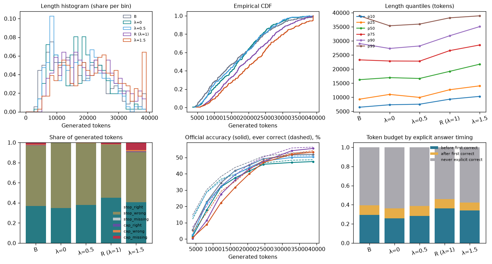
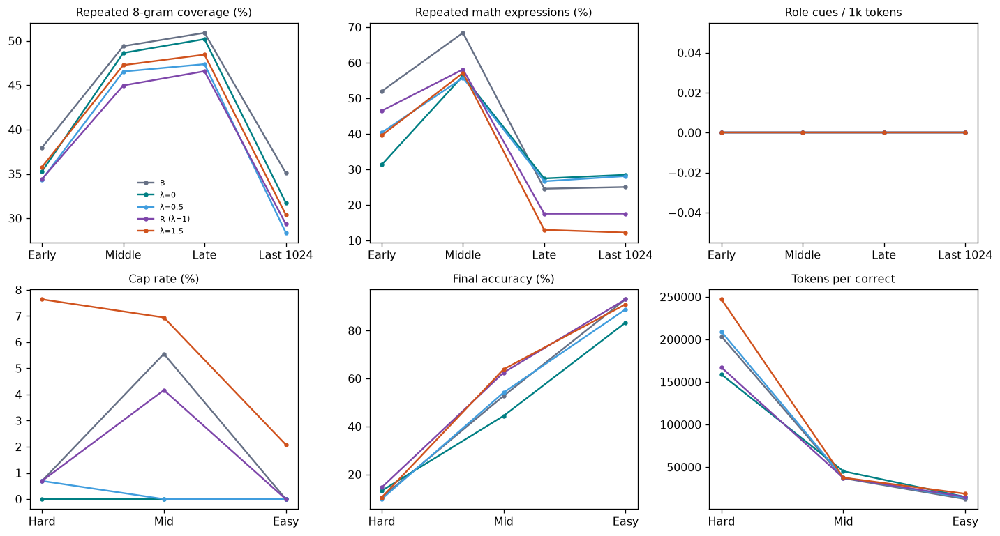
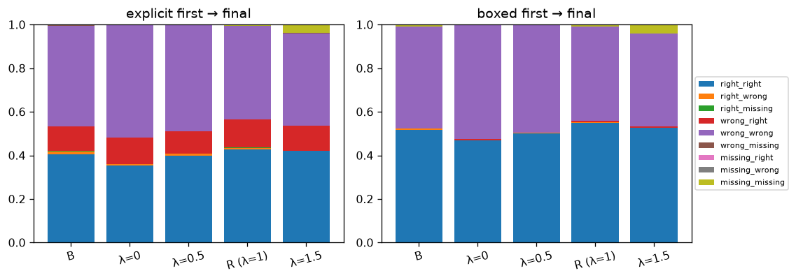
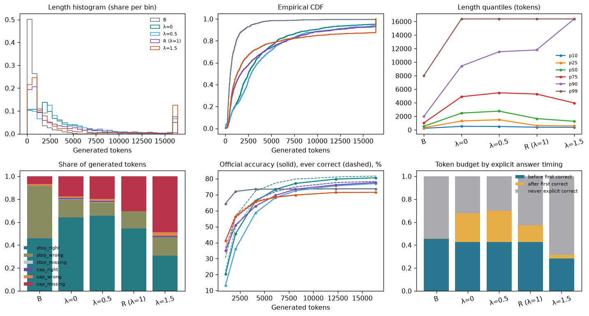
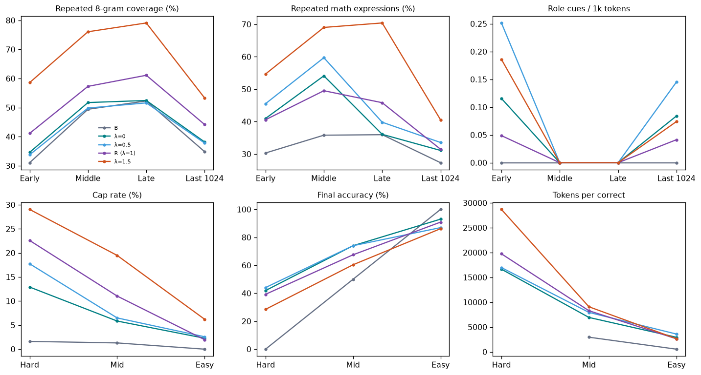
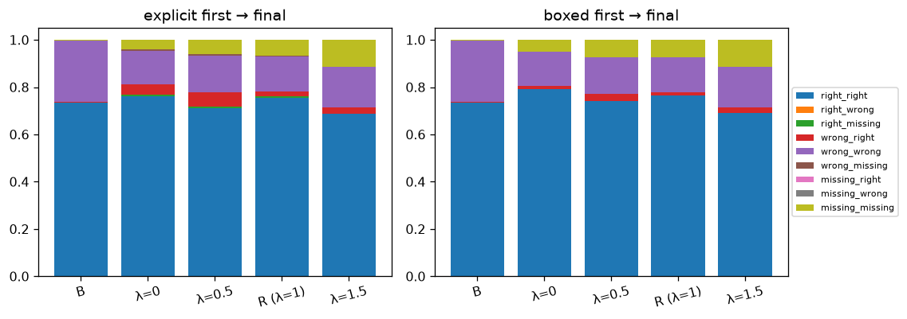

# λ 族的推理预算去了哪里

事后探索，单训练种子。读取 10 份有回执的生成归档，每份逐一校验 SHA-256、题序与采样数。AIME24 为 1,800 条，MATH-500 为 5,000 条。两种模式分别分析。

**MATH-500 非思考 16k 的主要变化是长尾分化，伴随可核实的数学循环。** λ=1.5 相对 R 平均只少 7 token，但中位数从 1,675 降至 1,278.5，P90 从 11,809 升至上限 16,384。每道题配对后，触顶率增加 5.3 个百分点 [3.0, 7.6]，最终准确率下降 6.2 个百分点 [−9.2, −3.3]。每个正确答案的总成本由 4,993 升至 5,416 token。在已经出现 explicit 正解的回答中，λ=1.5 平均早 571 token 出现；全体回答的首个正解后预算平均少 442 token。两项观察都与“主要因为已答对却迟迟不停”相反。

**AIME24 思考模式既有普遍变长，也有额外的极端尾巴。** λ=1.5 的中位数比 R 高约 2,541 token；均值高 1,874 [957, 2,811]。触顶率差 +4.2 个百分点 [0.8, 8.6]，准确率差 −2.2 [−7.5, +3.6]。R 与 λ=1.5 都在较高预算继续得到新正确答案；后者的额外开销没有显示出净准确率收益。全体首个正解时机的条件差为 +818 token [−723, +2,308]，方向未定。

## 全量分布与六类预算

下表是归档生成 token。完整的均值、总体标准差、P10/25/50/75/90/95/99、未触顶分布、缺答和条件缺答率，以及六个交叉分层的所有读数见 [summary.json](summary.json)。B 是独立基线。

### aime24

| 组 | 均值 | 中位数 | P90 | P99 | 触顶 | 缺答 | 触顶预算 | 准确率 | token / 正确答案 |
|---|---|---|---|---|---|---|---|---|---|
| B | 16983 | 16256.0 | 29082 | 38912 | 1.4% | 0.8% | 3.2% | 51.9% | 32694 |
| R-lambda0@100 | 17369 | 16981.0 | 27329 | 35382 | 0.0% | 0.0% | 0.0% | 47.5% | 36567 |
| R-lambda05@100 | 17139 | 16684.5 | 28212 | 35979 | 0.3% | 0.0% | 0.6% | 50.3% | 34090 |
| R@100 | 20006 | 19209.5 | 31842 | 38200 | 1.1% | 0.8% | 2.2% | 55.6% | 36010 |
| R-lambda15@100 | 21880 | 21750.0 | 35098 | 38912 | 5.3% | 4.2% | 9.4% | 53.3% | 41025 |

### nonthinking

| 组 | 均值 | 中位数 | P90 | P99 | 触顶 | 缺答 | 触顶预算 | 准确率 | token / 正确答案 |
|---|---|---|---|---|---|---|---|---|---|
| B | 985 | 545.0 | 2001 | 8013 | 0.5% | 0.4% | 8.3% | 73.7% | 1337 |
| R-lambda0@100 | 3894 | 2489.0 | 9432 | 16384 | 4.8% | 5.1% | 20.2% | 80.6% | 4831 |
| R-lambda05@100 | 4356 | 2781.0 | 11541 | 16384 | 6.0% | 7.5% | 22.6% | 77.0% | 5657 |
| R@100 | 3880 | 1675.0 | 11809 | 16384 | 7.2% | 7.4% | 30.4% | 77.7% | 4993 |
| R-lambda15@100 | 3873 | 1278.5 | 16384 | 16384 | 12.5% | 11.5% | 52.9% | 71.5% | 5416 |

## 预算曲线与可解析答案

原分词器回切完整轨迹。预算内自然结束的保留原文与归档分数；前缀按官方最后一个 boxed 提取、判分。虚线为此前任一次 explicit 命中。两条曲线回答不同问题，不能作为独立短预算生成的因果效应。MATH 在 2,048 token 的官方准确率 λ=1.5 为 56.3%，R 为 51.0%；到 8,192 时是 69.8% 对 73.5%。λ=1.5 从 8k 延长到 16k 只增加 1.7 个点，R 增加 4.2 个点。AIME24 上 λ=1.5 从 16k 到上限由 31.7% 升至 53.3%，更多 token 确实让一部分解答完成。

下表为 explicit 口径。首个正解位置仅在可观察到正解的回答中平均。后续 token 包含必要验证、正常解答书写和可能的冗余。逐条 explicit / boxed 候选事件摘要、错误→正确及反向的次数、重复错误、提交是否复现较早候选均随逐轨迹文件提供。

| 模式 | 组 | 曾写对 | 首正解 token | 正解后占全部预算 | 曾对且触顶或缺答 / 曾对 | 错→对 / 对→错次数 |
|---|---|---|---|---|---|---|
| aime24 | B | 53.3% | 9333 | 10.0% | 2/192 | 69/32 |
| aime24 | R-lambda0@100 | 48.6% | 9188 | 10.6% | 0/175 | 97/56 |
| aime24 | R-lambda05@100 | 51.1% | 9517 | 10.3% | 0/184 | 72/38 |
| aime24 | R@100 | 56.4% | 12883 | 9.6% | 1/203 | 80/36 |
| aime24 | R-lambda15@100 | 54.2% | 13701 | 8.4% | 1/195 | 103/63 |
| nonthinking | B | 73.8% | 605 | 0.5% | 0/738 | 3/2 |
| nonthinking | R-lambda0@100 | 81.7% | 2034 | 25.2% | 9/817 | 163/119 |
| nonthinking | R-lambda05@100 | 78.3% | 2382 | 27.0% | 12/783 | 158/99 |
| nonthinking | R@100 | 78.4% | 2104 | 14.8% | 6/784 | 53/31 |
| nonthinking | R-lambda15@100 | 71.5% | 1533 | 3.4% | 2/715 | 40/13 |

## 控制题目难度

B 正确次数定义难/中/易；AIME24 为 0–3、4–8、9–12，MATH 为 0、1、2。差值为 λ=1.5 减 R，95% 百分位区间按题配对重抽 10,000 次，种子 20261124。[所有组间同题比较](paired.json)还含重复等式、角色标记和额外 token。经验难度来自有限次解码。不同组发生正确事件的题目可能不同，时机指标存在选择效应。

| 模式 / 难度 | 题数 | 长度差 | 触顶差 pp | 准确率差 pp | 首正解位置差 | 每条正解后 token 差 | 重复8元组覆盖差 pp |
|---|---|---|---|---|---|---|---|
| aime24 all | 30 | 1874.3 [957.0, 2810.8] | 4.2 [0.8, 8.6] | -2.2 [-7.5, 3.6] | 818.3 [-723.4, 2307.8] | -82.7 [-426.1, 243.3] | 1.4 [0.3, 2.5] |
| aime24 hard | 12 | 1372.7 [-292.7, 2840.7] | 6.9 [0.7, 16.0] | -4.2 [-10.4, 1.4] | -924.4 [-6117.9, 5881.9] | -162.1 [-456.4, 106.5] | 1.5 [0.2, 2.7] |
| aime24 mid | 6 | 684.8 [-494.3, 1880.2] | 2.8 [-2.8, 9.7] | 1.4 [-20.8, 27.8] | -2224.5 [-4681.0, 851.4] | -93.3 [-1037.0, 909.5] | -1.7 [-3.5, 0.1] |
| aime24 easy | 12 | 2970.7 [1707.6, 4442.2] | 2.1 [0.0, 6.2] | -2.1 [-6.9, 2.1] | 2340.9 [1082.7, 3967.4] | 1.8 [-643.3, 608.0] | 2.7 [1.1, 4.7] |
| nonthinking all | 500 | -7.3 [-324.1, 308.5] | 5.3 [3.0, 7.6] | -6.2 [-9.2, -3.3] | -571.0 [-759.9, -391.3] | -441.7 [-547.7, -344.2] | 7.0 [5.7, 8.3] |
| nonthinking hard | 93 | 425.1 [-527.8, 1370.0] | 6.5 [-0.5, 14.0] | -10.8 [-18.8, -2.7] | -1476.1 [-2442.0, -470.8] | -494.1 [-749.8, -267.5] | 10.5 [7.4, 13.5] |
| nonthinking mid | 77 | -110.8 [-1005.2, 793.5] | 8.4 [1.3, 15.6] | -7.1 [-16.2, 2.6] | -592.3 [-1250.6, 57.0] | -731.1 [-1164.3, -376.9] | 9.4 [5.4, 13.5] |
| nonthinking easy | 330 | -105.1 [-430.7, 226.0] | 4.2 [2.0, 6.7] | -4.7 [-7.9, -1.5] | -369.5 [-514.6, -227.4] | -359.5 [-464.5, -257.8] | 5.5 [4.0, 6.9] |

在 MATH 的 B 两次都答对的 330 题上，λ=1.5 的准确率仍比 R 低 4.7 个点，触顶率高 4.2 个点。AIME 简单带的首正解推迟约 2,341 token；难题带的条件时机区间很宽。额外开销不能单独归给对难题的有效探索。

## 固定前缀与实际生成

| 组 | 内容熵 | 老师 top-1 | 原老师 KL | stop05 停止概率 | AIME 触顶 | MATH 触顶 |
|---|---|---|---|---|---|---|
| B | 0.858 | 72.9% | 0.817 | 86.5% | 1.4% | 0.5% |
| R-lambda0@100 | 1.241 | 79.6% | 0.311 | 86.5% | 0.0% | 4.8% |
| R-lambda05@100 | 1.346 | 74.7% | 0.364 | 90.2% | 0.3% | 6.0% |
| R@100 | 1.573 | 59.7% | 0.579 | 95.3% | 1.1% | 7.2% |
| R-lambda15@100 | 1.901 | 49.5% | 0.811 | 96.8% | 5.3% | 12.5% |

固定探针在预先定义的停止位置测条件概率；自由生成会改变沿途遇到的状态和次数。一个模型可以在探针上更倾向停止，同时更常走进持续输出同一表达式的状态。本审计没有反事实访问频率或状态迁移试验，五个聚合点不能识别这条因果链。

## 语义审阅与竞争解释

按模型、模式、终止原因及正误/缺答分层，每个非空格等概率抽一条，另每种模式随机抽一题取五组同题轨迹。固定种子 20261124，共 54 条。将模型、λ、最终分数与终止原因隐藏，按散列 ID 顺序审阅 20%、60%、94% 附近各最多 80 token；短回答的窗口可重叠。审阅者可见题目和标准答案，已知研究背景。定位与原文见 [盲审片段](blind.json)，逐段功能、依据见 [编码表](blind_readings.tsv)，模型、题序及抽样来源见 [解盲表](unblind.json)。另纳入上轮 [23 条 AIME 触顶全查及同题对照](../../cap_trajectories/REPORT.md)，该部分未盲，按轨迹全覆盖、分段审阅。两套样本有交集，不合并计算流行率。

编码 P 有效推进、V 有效验证、C 有效纠错、N 无效重复、F 无效反思、E 错误探索、O 无关语言或失调、A 有依据答案后的冗余、U 混合或难定。只就实际可见片段编码。没有用 n-gram 阈值判断数学效用。

- **同题逆例。** AIME 题序 26，R 与 λ=1.5 都按最大元素分组，用 2024 的二进制展开得到正确结果（4facf9fa、9141b213）；B 猜测 66。MATH 题序 482，R 正确数出 1,005 个奇数，λ=1.5 使用错误的分子和分母，B 也误数分母；λ=0、0.5 都正确。相同采样序号只用于定位。
- **反思能否撤回错误前提。** 8bf2a92b 一再意识到题目要求带分数，却仍反复提交同一个根式。fcd0f76e 用 12 整除 9×8 的反例撤销了错误的整除推断；后续枚举不同余数是实际计算。
- **语言与任务相关性。** 图像交点题变成中文社会评论（4bd5a9c7），整数题变成英文教育政策叙述（9c6057cd）。两个例子来自 R，前、中、晚三个窗口都可见。87126085 的阿拉伯语仍在讨论售价和验算。无关内容确实存在；这些样本不足以归为 λ=1.5 专属或主要集中在晚段。
- **终止失调的阳性案例。** AIME 网格题 λ=1.5 已由隔板计数得到 45，又写了 2,621 token。另有三元组题在计出 601 后继续 8,025 token，原 explicit 漏检，单独保留人工证据。写出一个恰好正确的候选、充分推出答案、完成必要的书面解答，是三个可区分的节点。

未触顶且最终正确的 MATH 回答，λ=1.5 平均 1,678 token，R 为 2,726；重复 8-gram 的 token 加权覆盖率分别为 45.7% 与 40.7%。AIME 对应平均长度为 16,813 与 16,192，覆盖率为 40.2% 与 40.3%。不能从触顶尾巴推断所有正常正确回答全面变慢。

**判读。** H5 在 MATH 获得直接支持，H2 的数学停滞有原文和分段指标支持；H1 在 AIME 的部分轨迹成立。H3 的语言和格式崩坏、H4 的答案后滞留均有实例。MATH 上 λ=1.5 的正解后预算份额从 R 的 14.8% 降至 3.4%，不支持 H4 主导组间退化。AIME 的成本增加更广泛，同时存在有价值的新计算和失控循环。单凭文本无法精确拆出每个 token 的反事实价值，也不足以把所有数学错误、语言切换或反思判为失调。

## 复现与数据字典

使用 measure.py → summarize.py → figures.py → detail.py → write_report.py；sample.py 和 blind_readings.tsv 保存审计设计与判断。10 个 *.jsonl.gz 各含一个模型/模式的逐回答记录；q/j 为零基题序/样本号，hash 是题目 SHA-256，archive 是输入回执哈希。全部预算以实际生成 token 计；文本内部位置使用原 tokenizer 重分词，可能和原生成长度略有差异。

segments 的顺序为全体、前三分之一、中三分之一、后三分之一、最后 1,024 token（与前三段重叠）。coverage 统计较早出现过的 4/8/16-token 串在当前位置覆盖的 token 并集；longest 为可与较早位置精确匹配的最长连续片段，允许重叠。句、段、数学表达、等式、算式按公开正则统计，折叠空白后区分首次与重复；这些是词面代理，不识别代数等价变换。重复错误与候选变化按提取文本统计，正确性按官方数学判分。自动离题关键词、语言和角色线索既可能漏检也可能误报；尤其不要把零离题关键词当成零离题文本。分组分段表见 [SEGMENTS.md](SEGMENTS.md)，逐段引文和盲审判断见 [SEMANTIC.md](SEMANTIC.md)。完整分段计数和分母见 summary.json，paired.json 的重复覆盖是先逐回答归一化，再逐题平均。图中堆叠的前/后/从未正确份额则按 token 汇总。

版本固定于提交中的分析脚本与归档回执。原 tokenizer SHA-256 为 aeb13307a71acd8fe81861d94ad54ab689df773318809eed3cbe794b4492dae4，官方判分脚本 SHA-256 为 3e41466b7cf971bcefa8cf53275e78639b79e94b816d6665d044b25f65076450。数学判分使用 math-verify 0.8.0（沿用其超时处理）。
