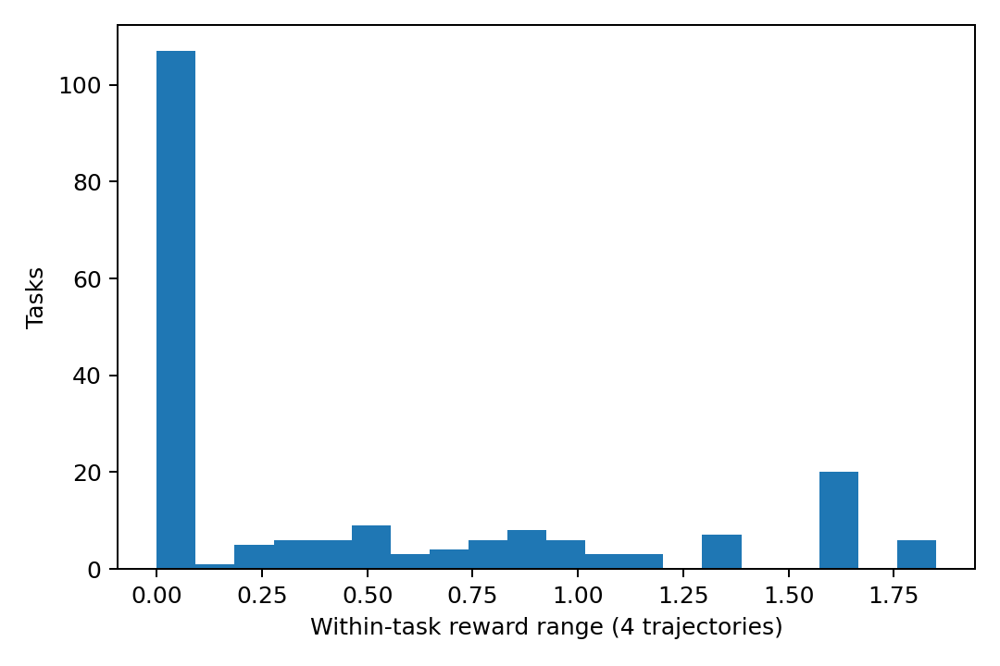
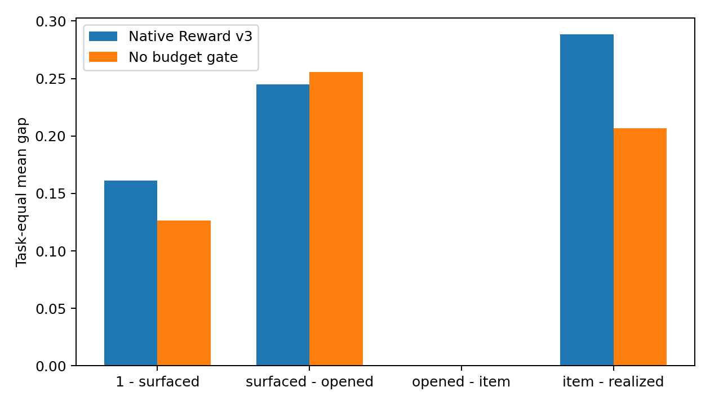
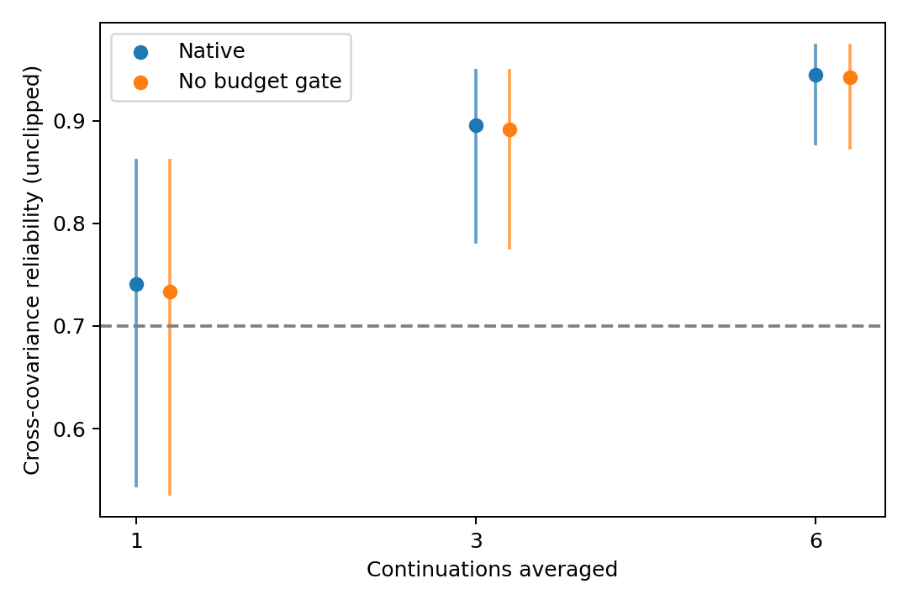
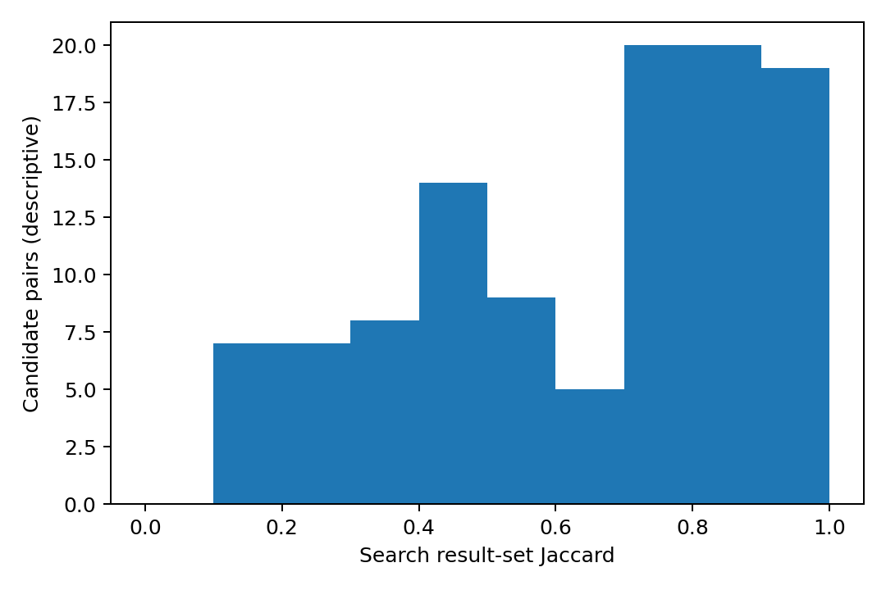

# 购物环境探索测量报告

**环境：社区 Environment v2.1 / Reward v3，35步原生终止；不是旧ShopSimulator奖励的复现。**

## 一页结论

- 规模：200题、800条正式轨迹；60个分叉点，35个可定义。采集完成标记：True。
- 环境验收：20×2策略试运行、20前缀双进程恢复、20隔离购买对分已通过；全库239,925规格值解析检查通过。
- 实际累计成本：0.3370 GPU小时（含初始化、失败启动与试运行），上限16；预算冻结为200题＋60状态。
- 预算门敏感性：去预算门后奖励改变比例 0.1388 [0.0988, 0.1837]（任务数=200）；均值差 0.0917 [0.0567, 0.1329]（任务数=200）。
- 历史截断：3/3438决策；3回合；移除7659token。
- CTHA：无奖励差异组 0.5200 [0.4500, 0.5900]（任务数=200），全失败组 0.4950 [0.4299, 0.5650]（任务数=200）。未触发但失败救援证据不足；本轮不自动启动训练。
- 停手：决策步可购买覆盖 0.5204 [0.5121, 0.5284]（任务数=200）；实际继续操作机会比例 0.7440 [0.6916, 0.7970]（任务数=197）。未触发止损；值得下一轮小规模训练对照，但尚无降方差或策略增益证据；本轮未启动训练。
- 回放：主估计可用状态 26，S=0.1182, N=0.0413, rho3=0.8956；可识别=True。触发止损：不继续该方向在当前设置下的训练或扩展。

以上区间为按任务聚类bootstrap 2000次的95%区间，先回合再任务等权。诊断性多指标不是确认性检验。未触发阈值不等于方法有效。

下一步判断：优先考虑停手基线的小规模训练对照；CTHA保留为待验证方向，先区分购买完成预测与失败救援信号。ALFWorld低信度现象未在本样本主口径复现，停止追加以低信度为动机的回放研究。本轮没有训练、32B评判或main合并。

## 奖励差异、停手和漏斗

奖励差异任务组 96；严格高低轨迹对 360。零分同分组 0.0250 [0.0050, 0.0500]（任务数=200）；负分同分组 0.1350 [0.0900, 0.1850]（任务数=200）；全部满分组 0.2600 [0.2000, 0.3200]（任务数=200）。

探针状态：`COMPLETED_PREDICTIVE_ONLY`。仅作预测性检查，详见metrics.json，不推断行为因果或训练收益。

前8步探针排序准确率 0.7168 [0.6460, 0.7870]（任务数=96）；动作／进度对照 0.6767 [0.6061, 0.7448]（任务数=96）；最终有效购买单变量 0.6576 [0.5988, 0.7184]（任务数=96）。相对100次组内打乱的差 0.2243 [0.1521, 0.2941]（任务数=96）。

两条轨迹均购买时，探针准确率 0.6176 [0.5136, 0.7213]（任务数=54），严格对172个。前8步都未购买的子集只有6个严格对，不能据此宣称全失败救援。78个商品大类留一验证不是ALFWorld原任务类型复现。

停手改善比例 0.4955 [0.4338, 0.5556]（任务数=197）；退步比例 0.2486 [0.2032, 0.2985]（任务数=197）；回合覆盖 0.9988 [0.9962, 1.0000]（任务数=200）。不可购买状态写NA，分母为零不补零。

| 漏斗项 | 原生奖励 | 去预算门诊断 |
|---|---|---|
| 1−Phi_surf | 0.1612 [0.1157, 0.2159]（任务数=196） | 0.1266 [0.0806, 0.1766]（任务数=196） |
| Phi_surf−Phi_open | 0.2450 [0.1910, 0.3025]（任务数=196） | 0.2555 [0.2017, 0.3136]（任务数=196） |
| Phi_open−R_item | 0.0000 [0.0000, 0.0000]（任务数=196） | 0.0000 [0.0000, 0.0000]（任务数=196） |
| R_item−R | 0.2883 [0.2271, 0.3541]（任务数=196） | 0.2067 [0.1594, 0.2592]（任务数=196） |

未纳入漏斗的回合：原生94，诊断94；逐条原因保留。目标商品最高原生分不足1的任务13。最大值来自原生评分函数穷举，不使用1000组合截断。

## 回放、候选集和信息

| 续跑次数 | 原生rho及95%区间 | 去预算门rho及95%区间 |
|---|---|---|
| 1 | 0.7410; [0.5444622230587224, 0.861574093716964] | 0.7336; [0.5357891426444966, 0.8611355496838652] |
| 3 | 0.8956; [0.7819271164075043, 0.9491669563408633] | 0.8920; [0.7759143704067084, 0.9489894849226652] |
| 6 | 0.9450; [0.8776196390295321, 0.9739206310859467] | 0.9429; [0.8738195668692457, 0.973827198381295] |

两库交叉选择相对原动作收益 0.1601 [0.0440, 0.3033]（任务数=35）。主估计只含至少两个非终止候选的状态，S不裁零；包含确定终止臂、草稿频次加权及100次随机拆分仅另列。

查询结果Jaccard 0.6572 [0.5575, 0.7457]（任务数=20）；集合完全相同率 0.0417 [0.0167, 0.0750]（任务数=20）。候选覆盖草稿质量 0.8458 [0.7812, 0.9084]（任务数=60）。这些是候选集条件下读数，不是完整策略概率。

S/F差异：库B -0.1537 [-0.3102, -0.0268]（任务数=22）；库A -0.1461 [-0.2970, -0.0224]（任务数=22）。解析或输入失败请求14个，未静默修复。一步反馈清洗和原文保留在候选及judge请求文件中。

每候选估值实耗 3.5383 秒（含确定终止臂）；两方向交叉库收益均为正的点7个，均超过.05的点7个。各机会成本及分离的前缀恢复成本见metrics.json；零机会分母写NA。

## 可见证据与限制

S/F容量偏离：16个尚未执行的完整请求超过8192输入，按信息对照生成前登记的SHOP-009，使用同checkpoint原生32768总上下文补执行。策略与续跑仍为8192；S/F前文相同，未删除F反馈，已有选择和解析失败未重跑。

以下可见性配对只针对当前打开商品。另对全部历史展示商品核查截断：丢失要求文本证据代理62条（逐决策计数），明细见truncation_lost_evidence.jsonl；不能把当前商品证据未丢失解释为整段历史没有损失。正式续跑截断5/3258个决策。社区公开key_attributes与原版页面不同，不能直接迁移旧环境的信息限制结论。

商品专属证据配对11122条，人工待复核抽样50条；逐字与规范化匹配分支持、显式否定冲突、未知。任务文本和其他商品的词不计入该商品证据。历史证据当前丢失0条，其中伴随截断0条。

该环境的预算来自任务显式文本，实际采用variant价格；不能沿用旧版“随机价格不可见”的结论。R_no_budget_gate仅对同一实际购买取消预算硬门，保留类别、软偏好及其余原生评分，非购买终止奖励不变。它不等于旧线性去价格分。

后台商品质量代理仅表示一步展示商品中可达的最高分，不是一步反馈全部信息价值的上界。后台评分从未进入策略或S/F输入。负奖励、主动停手和原生循环终止均保留；系统失败另记errors.jsonl。

## 复算

仅依赖保存数据：`python exploratory_shop_audit/analyze.py --run RUN_DIR`。精确商品评分原语由 `derive_environment.py` 使用冻结环境生成到r_star.jsonl；报告与图表复算无需环境或模型。

原始轨迹、模型输入token、后台明细、候选草稿、A/B续跑、S/F请求、冻结表和失败证据保存在运行目录。GitHub仅提交代码、报告与可审阅的汇总/验证证据，不提交权重或排除的原始回放。
