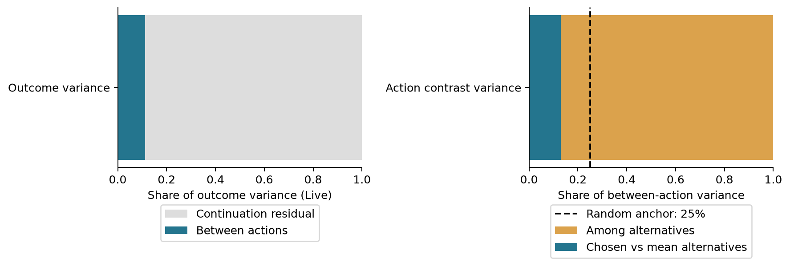
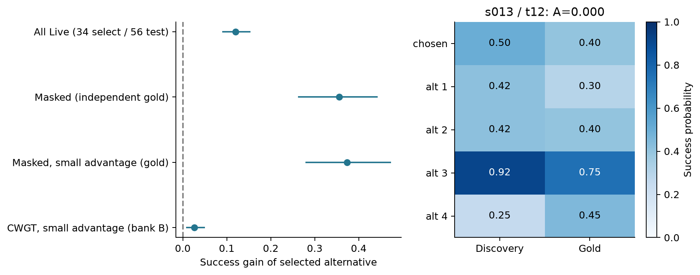
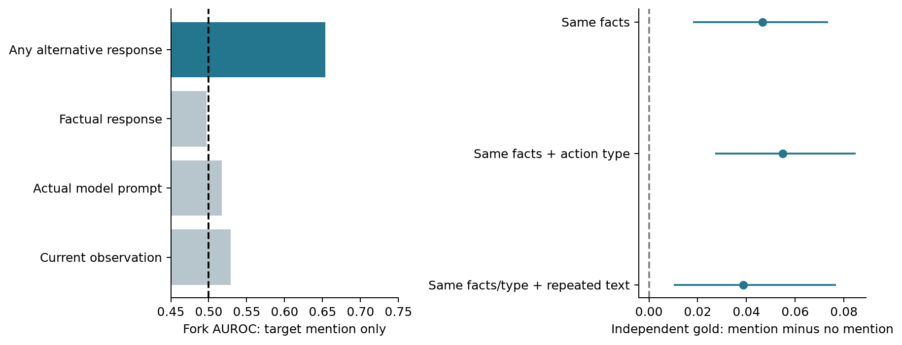
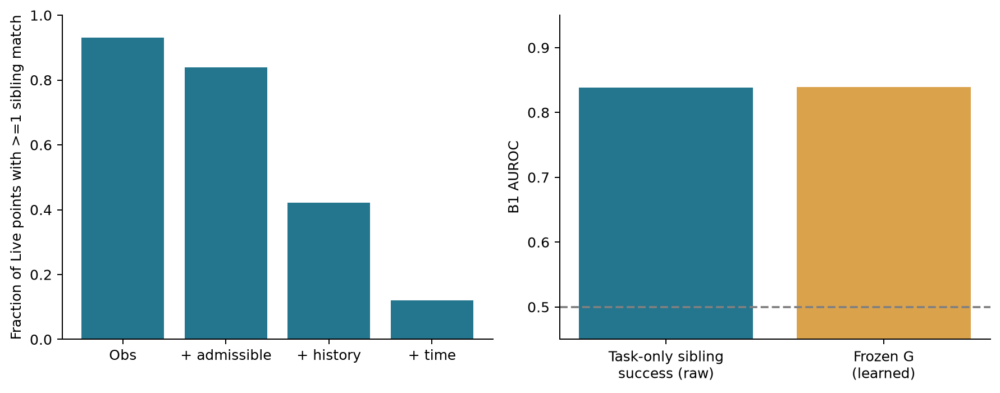

# Agent Credit Assignment：从信用压缩到上下文造成的长期分叉

日期：2026-10-27。性质：**冻结后探索性研究报告**。所有新增计算位于 `exploratory_deep_discovery/`；没有修改冻结标签、原始回放、主评估结果或预注册定义，没有启动 GPU 回放或训练。

**我的判断：最可靠的新结果是“均值信用不显著的地方，仍有可独立复现、可利用的动作改进机会”；最值得升级为机制论文的结果是“环境事实不变、甚至重复已有观察的动作，也可能改变长期成功率”。** 后者提示，我们测得的部分动作信用来自 Agent 上下文如何被更新，而不只是世界如何被改变。建议以第一个结果作为证据底座，用一次观察文本 × 动作记忆的交叉干预决定是否转向第二个故事。

当前不能写成“上下文机制已经被因果证明”。已执行回放干预了动作，但动作文字与返回观察一起变化；本次做了相同环境事实的对照，还没有单独干预观察。

## Part 1：重新理解研究本质

### 1.1 真正测量的对象

我们测量的是：在某条历史、剩余步数、固定提示模板和固定后续策略下，强制执行五个候选命令之一，会怎样改变最终成功概率。更完整的记号是

$$
q_a=Q^{\pi,M}(x_t,h_t,a),
$$

其中 $x_t$ 是环境状态，$h_t$ 是历史，$M$ 是把历史变成实际 prompt 的记忆规则。这里的 $M$ 只保留最近两轮 observation/action，策略为 Qwen2.5-7B-Instruct、温度 0.7，总步数上限 50。历史推理文字不进入后续两轮记忆。代码依据：[common.py](../scripts/common.py)、回放实现及实际 `prompts/`。

因此，当前数据不是“某动作的普遍因果重要性”，也不是最优策略下的 action value；它是**当前 Agent 系统的条件结果结构**。候选集为实际动作加四个已采样替代动作，其均匀参考分布也不等于完整策略分布。

从原始数据重新提取了：100 条主轨迹、700 条兄弟轨迹；3038 个可定义反事实的点，来自 98 条主轨迹；15190 个点—动作组合；209820 条已存在的续跑。其余主轨迹/步骤不满足候选定义，没有被补成零信用。Live 为 1478 点、79 条轨迹；Fork 为 475 点；Masked 为 305 点；B3 交集为 170 点。

| 数据池 | 每臂次数 | 本报告用途 |
|---|---:|---|
| 库 1–2 | 6 | 原 Live 筛选；辅助独立方向检查，披露筛选依赖 |
| 库 3–4 | 6 | 选动作、估计一个独立动作向量 |
| 库 5–6 | 6 | 验证前一个池选出的动作；估计另一个向量 |
| 库 3–6 | 12 | 冻结 Fork/credit 标签、发现池 |
| Gold | 20 | 300 个既定点的新随机种子回放；分开报告 200 unbiased 与 100 candidate 层 |

所有点的五臂顺序逐库核对；从原始成功计数算出的 advantage 与冻结 `A_3456` 一致。本文区间通常是按主轨迹聚类、4000 次 bootstrap 的 95% 区间；不是 3038 个点相互独立的区间。Gold 层内的探索子集也不自动代表总体。

### 1.2 研究如何走到现在

阅读了根目录研究文档、全部决策记录、四份 RULING/补充裁决、10 月 27 日 REVIEW、P1/P2/P3 与最初信息阶梯提案，并对照标签、peek、特征和评估实现。演变中有四次实质变化：

1. **从置信度到决策结构。** 最初关注前向过程在日志压缩中丢失什么；实际发现 thought-conditioned command logprob 退化，转向裸 prompt 的候选分布与隐状态。标量置信度失败，不能直接推导“前向信息无用”。
2. **从非零回放信用到可恢复性。** 早期低样本的 pivotal 判据大幅受 pooled outcome 是否非常量影响。P1 将“这个点有没有成功可能”和“当前动作有没有相对贡献”拆开，并采用多池回放。
3. **从一个 chosen contrast 到整个动作集合。** P2/P3、D-044 与最终补充冻结把 B2 改为五臂异质性。这是重要科学进展：它揭示了 chosen-vs-mean 检验没有覆盖的结构，而不只是换了标签名。
4. **从模型侧特征到环境响应。** D-046–D-049 加入 G/W1 并完成 Phase 3；D-050 暴露 B+C 堆叠实现问题。已有叙事进一步将 G/W1 的分工解释为世界信息的重要性，但还没有定位信息如何改变后续行为。

两点旧解释应停止沿用，因为会改变科学结论：Indifferent 是未检出异质性，不能写成“真实 advantage 恒为零”；B3 功效不足，不能写成“只有回放能提供符号”。同理，回放深度增加时符号一致率变化小，不是零效应或不可识别性的证明。

**B+C 状态：** 当前修复脚本已经存在，但两个修复运行日志都是 exit 137，`eval/main.json` 的 B+C 行没有完成修复的标记。本报告不使用旧 0.514 或旧 B+C−W1 差值支持任何新结论，也不宣称修后正式判定必定不变。没有把尚未完成的修复当作结果。

### 1.3 信息阶梯现在应该怎样理解

冻结结果仍显示：B/C/V 对 B1 有信息，G 的 B1 约 0.84；W1-pure 的 B2 约 0.67，`target_revealed` 约 0.65；回放强于廉价信号。具体主表见 [RESULTS.md](../RESULTS.md)。

这支持两类不同的信息缺失：

- **表征压缩：** 一个已执行动作的置信度，不足以概括候选动作结构；一个 chosen advantage，也不足以概括替代动作之间的差别。
- **未观察反事实：** 未选动作会返回什么环境信息，原 factual 日志通常没有记录。不能把这类信息说成“模型前向时已经存在、后来丢了”。

对最初假设的支持是局部的：结构优于标量、动作对应关系有用、非事实响应提供新增信息。尚不支持“只要保存更多隐状态就能恢复全部信用”，也不支持“廉价前向信号原则上不可能预测动作贡献”。

“Siblings Find the Dead, Peeks Find the Fork”有辨识度，但目前主要是信息源 × 预测目标的经验分工。本次发现可以解释它的一部分：G 很大程度上测到了任务层成功基率；W1 提供了某个候选动作会怎样改变世界响应和后续输入。二者面对的不是同一个统计对象。

## Part 2：最值得注意的隐藏现象

### 2.1 Masked 包含大量稳定的改进机会，但不是普遍的正负抵消

**已验证结果。** 用库 3–6 在四个替代动作中选成功率最高者，再用不参与选择的结果池评估它与 chosen 的差值：

| 样本 | 点数 / 轨迹数 | 独立评估成功率增益，百分点 |
|---|---:|---:|
| 全部 Masked，库 1–2 评估 | 305 / 53 | +35.8 [29.3, 41.9] |
| 有 Gold 的 Masked | 53 / 28 | **+35.6 [26.2, 44.3]** |
| Gold unbiased 层中的 Masked | 36 / 20 | +38.9 [29.2, 47.1] |
| Gold candidate 层中的 Masked | 17 / 16 | +28.5 [14.2, 43.4] |
| Masked 且发现池 $\lvert A\rvert\le 1/12$，Gold 评估 | 15 / 10 | **+37.3 [27.9, 47.3]** |
| 全 Live：库 3–4 选、库 5–6 测 | 1478 / 79 | +12.0 [8.9, 15.4] |

第一行的评价池同时参与过 Live 筛选，因此独立 Gold 和最后一行更关键。Gold 的 53 点中，34 点的单个、预先选定替代动作在独立 Newcombe 90% 区间下显著优于 chosen；这是探索性点级统计，不是做了所有 pair 后挑测试集最优。

305 个 Masked 中，只有 13 个的**样本** advantage 恰为零，112 个满足 $\lvert A\rvert\le1/12$。发现池的未校正 pairwise 检验中，228 个有显著更优替代，89 个有显著更差替代，同时有两者的只有 32 个，即 10.5%。原始点估计的上下夹击虽常见，却不足以证明真实正负抵消。

因此更准确的结论是：**对 chosen 的平均相对评价未被检出，不等于没有可学的动作偏好。** 这个现象混合了参考分布的平均化、小效应、有限样本功效以及部分真实抵消；不要把 64% 全部包装为 cancellation。

chosen 的独立排名也不是“通常最差”：五臂中平均排名在库 1–2 为 3.20，Gold 为 3.17（并列取中间名次）。价值来自识别更好的替代，不要求把原动作定性为最坏动作。

**原始案例。** `s013/t12`，任务是清洗刀并放到餐桌：五臂发现池成功率为

$$
(0.50;\ 0.417,0.417,0.917,0.25),\quad A=0.
$$

chosen 为 `examine cabinet 3`；发现池选择 `go to drawer 1`。Gold 中分别为 8/20 与 15/20，差 +35 个百分点。此时该 drawer 的一步观察只是“抽屉关着”，尚未提到刀；下一步 10/12 次选择打开抽屉。**这也说明 W1 的 target bit 不是全部长期机会。** 详见 [原始回放](../data/replay_b2/s013/t12.json)、[Gold](../data/replay_gold/s013/t12.json)。

反例也保留：`s046/t12` 的样本 A 同样为零，但发现池选出的替代在 Gold 只比 chosen 高 5 个百分点；另一替代反而更好。不是每个漂亮的发现池向量都会复现。

**是否值得继续：最高。** 它已经连接了统计结构与实际动作选择，不依赖新增训练。

### 2.2 当前动作能控制的方差很小，而其中多数又不在 chosen contrast 上

**已验证结果。** 利用库 3–4 与 5–6 的交叉乘积，去掉直接对 noisy success rate 求方差的向上偏差：

| Live 上的平均量 | 估计与 95% CI |
|---|---:|
| 总二元结果方差 $T$ | 0.14970 [0.13616, 0.16231] |
| 不同当前动作间的均值方差 $C$ | 0.01675 [0.01314, 0.02056] |
| 固定动作后的残余方差 $N$ | 0.13295 [0.12065, 0.14475] |
| $\sum C/\sum T$ | **11.2% [9.0%, 13.5%]** |
| chosen contrast 占 $C$ 比例 | **13.0% [10.1%, 16.5%]** |
| 替代动作内部差别占 $C$ 比例 | 87.0% [83.5%, 89.9%] |

直觉上，终局很不稳定的点可能被视为当前动作值得学习的点；这里近 89% 的结果方差发生在固定当前命令之后。它在当前协议下主要来自后续策略采样，不能归给当前选择。

但 **87% 不能直接作为惊人的普适常数**：五臂中心化空间有四维，chosen-vs-mean 只是一维。随机均匀选择 anchor 时，这一维平均占 25%，剩余本来就占 75%。值得研究的是本数据的 chosen 仅占 13%，而不是“87 大于零”。CWGT 独立资料中相同分解的替代内部份额为 70.4% [53.2%, 84.9%]，并不复现 87% 或高于 75% 的命题。

**机制解释。** pooled uncertainty、动作可控性、chosen 相对评价是连续的不同对象。数学是已有恒等式；本数据的相对大小以及与 Masked 实际机会的联系才是经验发现。推导见 Part 3。

**是否值得继续：作为解释骨架，值得；作为新理论主贡献，不值得。**

### 2.3 W1 的主要预测信息来自未选动作响应，不是 factual 日志已有目标信息

**已验证结果。** 在同一 1478 个 Live 点上，用单个二元变量预测 Fork：

| 信号 | B2 AUROC |
|---|---:|
| 当前 observation 出现目标实例 | 0.529 |
| 实际 prompt 出现目标实例 | 0.517 |
| 全 factual 历史曾出现目标实例 | 0.513 |
| chosen 执行后的 response 出现目标 | **0.497** |
| 任一未选动作的 response 出现目标 | **0.653** |
| 五臂任一 response 出现目标，即原 `target_revealed` | 0.653 |
| 任一 response 引入历史未见目标实例 | 0.630 |
| 某臂新开放 `take target` 合法操作 | 0.655 |

固定 C=1、按轨迹 GroupKFold 的小型探索逻辑回归，以 turn、合法动作数、当前 observation 与 prompt 目标存在为控制：加入 factual response 后 AUROC 0.515；再加入 alternative response 后为 0.689，配对增量 0.174 [0.102, 0.242]。这不是重新优化主模型，而是回答一个具体问题：简单日志中已有的目标线索能否解释 W1？本次对照不能解释。

同时，`target_revealed` 这个名字容易误导。937 个含目标的 Live peek 集合中，68.1% 的点在 factual 全历史已经出现过目标；65.2% 的实际 prompt 已有目标。仅 35.9% 的点有某臂引入历史未见的目标实例。这里“新”只指对象实例 ID，不能等同于所有语义属性都已知。

上述“全历史”具体包括此前及当前 observation 与合法动作列表；不是未保存的内部认知状态。后续 `take` 指标记录目标相关命令出现，未将每条命令都判定为成功拿取。

**已有数据支持的机制。** 一步反馈把“候选命令”映射为“局部可用对象、操作机会和下一轮输入”。新目标相关的点，含目标响应的动作在后续三步内执行 `take target` 的概率比其他动作平均高 68.1 个百分点，最终成功率差为 37.0 个百分点。该使用标记排除了强制动作自身，但包含物理可达性差异，不能视为已识别的因果中介。

**没有使用收益的案例。** `s003/t23`：`go to stoveburner 1` 第一次呈现 `pot 1`；后续 12 次中 5 次下一步直接拿锅，但发现池和 Gold 的该臂成功率都为零。任务要求先冷却锅再放到炉灶，发现和拿到目标仍未跨过后续执行瓶颈。见 [回放](../data/replay_b2/s003/t23.json)。

**是否值得继续：高。** 对“世界响应提供什么”已有强证据；“新信息本身导致成功”仍需干预。

### 2.4 更意外的是：世界事实相同、甚至文本重复，也存在长期差异

**已验证结果。** 在同一决策点，将含目标响应的动作与不含目标响应的动作成对比较；要求执行后 TextWorld 完整事实增删集合相同。得到 337 对、257 点、30 条轨迹；这些对全部没有事实变化。另核对了执行后合法动作集合、done、won，差异均为零。同一点多个动作对先取平均，避免多对点获得更高权重。

| 对照子集 | 发现池点数 | 发现池差值，百分点 | Gold 点数 / 轨迹数 | Gold 差值，百分点 |
|---|---:|---:|---:|---:|
| 相同环境事实 | 257 | +5.37 [2.82, 7.91] | 55 / 21 | **+4.67 [1.81, 7.35]** |
| 再限制相同动作类型，均为 examine 对 | 232 | +5.66 [2.76, 8.43] | 52 / 18 | +5.48 [2.72, 8.49] |
| 相同事实、类型，目标 response 逐字已在当前 prompt | 134 | +3.98 [1.42, 6.40] | 33 / 12 | **+3.86 [1.02, 7.67]** |
| 相同事实、类型，response 为 “There's nothing special about …” | 124 | +6.12 [2.54, 9.40] | 29 / 10 | +6.90 [3.23, 9.87] |

更严格子集有样本限制：不限制动作类型、仅要求文本已在 prompt 的 36 个 Gold 点，差值 +2.55，区间 [-0.22, 5.70] 个百分点。必须同时展示这一结果，不能只选择区间不跨零的切片。多个子集有重叠，不能当成独立重复实验。

**原始案例。** `s017/t29`，目标是把 newspaper 放到 ottoman。执行前 prompt 的 Observation 27 已逐字出现 `There's nothing special about newspaper 1.`，合法动作中也已有正确放置命令。

| 强制动作 | 新返回文本 | 库 3–6 成功 | Gold 成功 | 后续第一个动作 |
|---|---|---:|---:|---|
| `examine newspaper 1` | 同一句 nothing special | 12/12 | 18/20 | 9/12 直接 `move newspaper 1 to ottoman 1` |
| `examine ottoman 1` | 列出 ottoman 上的其他物品 | 8/12 | 12/20 | 8/12 转而 `examine newspaper 1` |

两臂世界事实与合法动作相同，都花一步。返回 target 文本的一臂没有增加新对象，却更常把后续行为导向现成的完成动作。[实际 prompt](../prompts/s017/t29.txt)、[peek](../data/peek_alts/s017/t29.json)、[发现池](../data/replay_b2/s017/t29.json)、[Gold](../data/replay_gold/s017/t29.json)。该案例按发现池选择展示，不作为效应量估计。

另一个机制不同的案例是 `s025/t39`：任务要 hot potato，Agent 手上却是 cold potato。`examine potato 1` 返回其 cold 属性，发现池成功率 0.50；同世界事实的 `examine countertop 1` 为 0。前者下一步 5/12 去 microwave。这可能是属性检查而不是纯重复提醒，不能把两类案例混在“目标被揭示”中。

**已有数据支持的解释：** 部分信用通过下一轮输入/动作记忆形成，局部响应能够改变后续行动分布，而非必须先改变物理状态。

**待验证假设：** 提醒、注意力重定向、两轮记忆窗口的刷新、动作文字的自我提示，是竞争机制。逐字重复也可能确认信息仍然有效；事实一致仍不等于已穷尽引擎所有隐藏变量。一次交叉干预比再加几十个回归控制更有辨别力。

**是否值得继续：最高机制潜力。** 这是我建议下一轮集中资源的发现。

### 2.5 G 的强项主要是任务成功基率；93% 覆盖并不等于可比较的反事实样本

**已验证结果。** 完全不匹配当前 observation，只用同任务七条 siblings 的最终成功率，B1 原始 AUROC 已达 **0.838**；冻结 G 模型约 0.839。两种分数的训练方式不同，不能据此声称统计等价，但足以证明：当前 G 的总体高分不要求高质量的局部反事实匹配。

Live 上的实际覆盖如下：

| 匹配要求 | 至少有一个 sibling 匹配的点占比 |
|---|---:|
| observation 相同 | 93.1% |
| 再要求合法动作集合相同 | 83.8% |
| 再要求实际使用的最近两轮 observation/action 相同 | 42.2% |
| 再要求轮次相同，即对齐剩余预算与历史编号 | **12.0%** |

最后一项是本次实现的输入对齐条件，不是环境真实状态完全相等的证明；也没有把合法动作的排列顺序当作匹配条件。反过来，前一项 93% 并非“同一个决策状态被充分采样”。

不过，**纯粹“大家都选同一动作”被数据削弱了**。Masked 点平均有 24.9 次 observation 匹配访问，但来自 5.0 条独立 sibling，包含 5.82 种命令，支持五个 replay 动作中的 2.78 个；60% 的点至少有两臂各被两条 sibling 访问。G 对五臂内部中心化回放结果的相关也不是严格零：3955 个有支持的臂，Pearson 0.214（描述性，未将这些臂当成独立推断单位）。

动作支持更充分的 Live 子集（至少四个 replay 臂，465 点），G 的动作成功率离散度 B2 AUROC 为 0.592；全 Live 为 0.548。这方向符合支持不足假设，但选择后人群变了，不能把差值当因果证据。

**更符合数据的解释：** 任务难度、重复访问、历史/剩余预算混合和有限动作结果支持共同作用。我们目前能证明“粗覆盖不能保证有效支持”，还不能证明某一项是唯一瓶颈。

**案例。** `s046/t12` 有 46 次匹配、16 种命令，却没有一个满足上述完整输入条件的 sibling；Gold 中五臂差异也远弱于发现池。`s097/t38` 的七条 sibling 全成功，但在此点强制 chosen 的 Gold 成功率仅 5/20，另一个 examine 动作为 10/20。任务层很容易，并不等于当前历史仍容易。

**是否值得继续：作为双重分离的解释，值得；作为“GiGPO 无效”的论证，不成立。** 这里没有训练 GiGPO，也没有复现其训练分布。

### 2.6 机会集中在少数点，任务和时间结构又会改变观察到的“稀疏性”

用库 3–4 估计替代改进幅度并排序，用库 5–6 评估同一个替代动作：Live 的前 10% 点贡献全体净增益的 49.4%，前 20% 贡献 77.8%。前 10% 的平均独立增益为 +59.3 [50.5, 66.4] 个百分点。这里按 signed net gain 求和，其他点可能有负增益；它不是绝对价值份额，更不是这些点能被免费 oracle 识别。

任务差异很大：

| 任务 | 可定义点 | Live | Fork | Fork / Live |
|---|---:|---:|---:|---:|
| light | 405 | 218 | 93 | 42.7% |
| simple place | 420 | 328 | 112 | 34.1% |
| clean | 432 | 309 | 118 | 38.2% |
| cool | 618 | 245 | 53 | 21.6% |
| heat | 510 | 357 | 98 | 27.5% |
| two objects | 653 | 21 | 1 | 4.8% |

two-object 的 653 点几乎被当前策略压进低成功区域。不能据此推断这类任务天然没有关键动作。

失败主轨迹早/中/晚三段的 Fork/Live 为 28.4%/30.9%/42.4%；但 Fork/全部可定义点为 15.3%/14.9%/9.8%。**“越晚越关键”和“越晚越没有关键点”可以同时由不同分母得到。** 成功轨迹对应 Fork/Live 为 31.4%/28.4%/38.3%。没有充分理由宣布统一的晚期关键性规律。

字面相邻可定义点中，Dead 后转 Live 为 110/1305，8.43% [5.84%, 11.49%]；Fork 后仍为 Fork 为 175/399，43.9%。标签存在时间结构，但前者已经说明有限采样 Dead 不是吸收态；后者尚不能区分轨迹难度与真正的关键性自激依赖。本报告没有把邻接频率提升为新规律。

**是否值得继续：** 独立确认的机会集中有预算价值；轨迹阶段关联暂不单独发展论文。

## Part 3：四条最有潜力的科学命题

### 命题一：一个动作的平均相对信用，会遗漏同一状态下稳定的改进方向

**一句话：** 当前动作的 chosen-vs-reference 信用近零，并不意味着该状态缺乏可利用的策略改进机会。

设五臂均值 $\mu=\frac15\sum_{a=0}^4q_a$，chosen 为 0，$\bar q_-=\frac14\sum_{a=1}^4q_a$，$A=q_0-\bar q_-$。由全方差公式：

$$
\underbrace{\mu(1-\mu)}_T=
\underbrace{\frac15\sum_a(q_a-\mu)^2}_C+
\underbrace{\frac15\sum_aq_a(1-q_a)}_N.
$$

再把动作方差正交分解：

$$
C=\frac4{25}A^2+\frac45\operatorname{Var}_{a\in\{1,2,3,4\}}(q_a).
$$

第二项完全可以在 $A=0$ 时很大。更直接地，$q=(.5;.1,.3,.7,.9)$ 时，A=0，但换成最优替代的 gain=0.4。注意这里是数学示例，真实案例为前述 `s013/t12`。

为避免 plug-in 噪声，用独立池 $u,v$ 估计

$$
\widehat C=\frac15\sum_a(\hat q^u_a-\hat\mu^u)(\hat q^v_a-\hat\mu^v),\qquad
\widehat C_{\rm chosen}=\frac4{25}\hat A^u\hat A^v.
$$

交叉乘积在固定候选集、独立续跑下无偏，单点可以为负，不截成零。本次直接 plug-in 的 C 为 0.02564，比交叉估计 0.01675 高约 53%。这是采用多池而不是继续堆显著性检验的原因。

**Surprise 与边界。** 反直觉点是实际效应大小与遗漏机会的密度，不是线性代数。它挑战把单个 chosen 信用当成“此状态是否值得学习”的筛选器；不推翻 policy gradient。完整的所有动作 advantage 向量仍保留偏好，标准随机策略梯度也不要求只学习显著非零的单个样本。本项目均匀替代基线不是严格的 $V^\pi$。

**两条预测。** 第一，按 $\lvert A\rvert$ 或 chosen 显著性筛点，会漏掉独立回放可改善的点；按动作向量差异/最佳替代潜力筛点应少漏。第二，保留同一个动作分数集合、随机打乱分数与命令的对应，异质性不变，实际选动作收益应下降。前者已有 Masked 证据，后者可在预算匹配的单次修复实验直接验证。

**最简替代解释与决定性实验。** 有限回放挑最大值造成赢家偏差，是最可能的解释；分池和 Gold 已实质排除“全是噪声”。剩下关键问题是能否在新任务、按同预算候选生成成本，真正执行一次改进。无需先训练新 RL 算法。

**新颖性。** “动作均值与动作条件值不同”早已有之；CWGT 已做独立池恢复选择，BiPACE 已讨论组均值过粗。我们的增量是识别了被 chosen 信用筛选遗漏的具体人群、独立确认其大幅可改进性，并把它与可获得的动作对应反馈连接。单独作为顶会主贡献仍需一个实际闭环。

### 命题二：部分长程信用来自上下文转移，而不是环境状态转移

**一句话：** 对当前有限记忆 Agent，有些动作通过重新组织下一轮可见信息产生长期价值，即使它们没有改变世界事实，也没有产生新的观察文本。

令动作后的世界为 $x'=F(x,a)$，响应为 $o'=O(x,a)$，下一轮记忆为 $m'=M(h,a,o')$。则

$$
Q^{\pi,M}(x,h,a)=\mathbb E[V^{\pi,M}(x',m',b-1)].
$$

若两个动作的 $x'$、剩余预算、合法动作都相同，仍可能因为 $m'$ 不同而有不同 q。对真正基于充分信念状态、且不受无关动作记号影响的策略，完全无新信息的等价响应不应造成这种差别；实际语言策略没有自动满足这个不变性。

**与数据联系。** 257 点同事实差异、134 点相同动作类型且逐字重复的子集、`s017` 的下一步行为变化，以及 Action-Aligned Peek 的信号，都符合这条路径。当前没有直接测量 attention，也没有证明两轮窗口遗忘是唯一原因。

**两条竞争性预测。** 第一，固定环境与记录的动作文字，交换 target / distractor observation，若成功率与下一步完成动作随 observation 移动，支持观察通道；若只随动作文字移动，支持自我提示。第二，使用稳定保留目标状态的结构化记忆后，重复提醒类动作之间的 q 差异应缩小；真正新发现目标或改变物理可达性的动作差异不应同幅消失。仅增加上下文长度，不一定有同样效果，因为信息存在与被使用不同。

**决定性实验。** Part 5 的 2×2 交叉干预。主要替代解释——动作文字、世界差别、新属性信息——可以在同一次实验中分开；无需大规模扫特征。

**新颖性与潜力。** POMDP/记忆参与状态不是新理论，提示可影响行为也不新。更有辨识度的贡献是：用真实反事实动作信用证明“表面无进展/重复观察”的动作仍可具有终局价值，再用干预定位信用由何种上下文更新产生。这也给基于重复观察惩罚的设计提出具体条件，而非泛泛主张“记忆很重要”。

### 命题三：识别动作信用所需的支持，是可比较的动作对比支持，而非访问数量

**一句话：** 大量相同观察的轨迹可以准确描述任务成功基率，却未必支持当前历史下的动作反事实。

兄弟轨迹估计的通常近似为

$$
\mathbb E[Y\mid O=o,A=a]
=\sum_{h,b,x}Q(x,h,a,b)P(h,b,x\mid O=o,A=a),
$$

而目标是固定当前 $(x,h,b)$ 的 q。即使不同动作都有样本，动作组中混合的历史、预算和潜在状态也可能不同。增加同类访问量，只会更精确估计这个混合量。重复访问同一 episode 还重复使用同一个终局标签。

**Surprise。** 93% observation 覆盖与有效决策支持不足可以同时存在；另一方面，本数据并不是简单的动作塌缩。任务级 sibling 基率 0.838 已解释了为何 G 能做 B1，却不足以识别同一轨迹内部的动作机会。

**两条预测。** 第一，在固定总续跑预算下，固定前缀后分层强制不同动作，应比增加 observation 匹配访问更有效恢复动作差异；若两者相当，则支持问题不是主因。第二，在保持访问数和动作数不变时混合不同剩余预算/记忆，应更伤害动作排序而非任务成功基率；若不受影响，则上下文混合解释弱化。

**决定性实验。** 仅在机制实验选出的同世界、不同上下文前缀中比较“同上下文不同动作”和“同观察不同上下文”的小组估计；可共用回放预算。没有必要现在额外生成几千条自然 siblings。

**新颖性。** overlap/positivity、状态混合和 action-conditioned value 都是已知概念，BiPACE 直接相关。这里的独特证据是粗覆盖 → 输入条件匹配覆盖的实测坍缩，以及 task-only 对 G 整体性能的解释。适合支撑主故事，暂不独立扛论文。

### 命题四：信息动作的信用取决于后续策略能否保留并利用它

**一句话：** 获得信息、把信息放在当前上下文、依据它采取有用动作、最终完成任务，是不同环节；动作信用由整条路径决定。

可用一个受限机制模型表达：若臂 a 改变某个有用信息变量 Z 的可用性，且后续差异只通过是否实际利用 U 传递，则 q 的差异与 $P(U=1\mid a)$ 的差异成比例，比例系数是利用后获得的终局收益。**这里的中介充分性假设尚未成立**；它是设计干预的模型，不是本数据已估出的因果分解。

**与数据联系。** 新目标响应常迅速触发 take，但 `s003` 说明 take 仍可能没有终局回报；已知目标的 examine 有时把 Agent 导向完成动作；固定动作后的残余方差又远大于当前动作方差。

**Surprise。** 提高后续策略能力，可能让某些信息动作更重要，也可能让原先高信用的重复提醒动作失去价值。没有单调的“更强 Agent → 每一步信用更强”。

**两条预测。** 第一，结构化记忆提升对已知事实的利用后，重复提醒动作的 q gap 缩小，但稀缺事实揭示动作的 gap 可能增大。第二，仅注入缺失信息能提升早期使用率，却未必改善需要冷却/加热等后续技能的终局；若再固定一个能够完成后半程的 continuation，原先无回报的信息动作才变得关键。

**决定性实验。** 在观察交叉干预有正结果后，用同一候选动作、同一世界状态，对比原 continuation 与稳定记忆 continuation；先测信用的迁移，再考虑训练。主要替代解释是纯总能力变化，应报告同状态 action gap 的差中差而非仅成功率上升。

**新颖性。** 策略依赖的 Q 本身是教科书事实。高风险贡献在于揭示 LLM Agent 的记忆/使用机制怎样系统性改变哪些行为看起来“值得奖励”，并据此修正跨策略复用信用与重复行为惩罚的方式。

## Part 4：实际运行的探索、可视化与原始案例

### 4.1 可复现产物

| 脚本 | 实际输入与规模 | 输出及主要对照 |
|---|---|---|
| [exploratory_extract.py](../exploratory_deep_discovery/exploratory_extract.py) | 原始 rollout/siblings/replay/peek，3038 点、15190 臂、209820 续跑 | 三张精简 parquet；五臂对齐、原始 A 与冻结 A 一致、输入 SHA256 |
| [exploratory_analyze.py](../exploratory_deep_discovery/exploratory_analyze.py) | 上述数据、冻结标签与 G/W1/B 特征 | 方差分解、Masked、任务/时间、G 支持、W1 语义与后续行为；分池与轨迹 bootstrap |
| [exploratory_mechanisms.py](../exploratory_deep_discovery/exploratory_mechanisms.py) | Live1478、Masked305、Gold300、CWGT172 点 | 同事实动作对、pairwise 结构、固定小模型、臂对应置换、外部资料复算 |
| [exploratory_cases_and_figures.py](../exploratory_deep_discovery/exploratory_cases_and_figures.py) | 同事实337对及实际 prompt、原始案例 | 逐字重复子集、有效支持、独立增益集中度、7 个案例、4 张 PNG/SVG |
| [exploratory_cheap_selection.py](../exploratory_deep_discovery/exploratory_cheap_selection.py) | 五臂响应、所有现有池 | 不使用结果的三个动作选择规则；factual/uniform 对照；同事实对的 admissible/done/won 核对 |

执行入口与依赖见 [README](../exploratory_deep_discovery/README.md)。主数值文件为 [results](../exploratory_deep_discovery/exploratory_results.json)、[mechanisms](../exploratory_deep_discovery/exploratory_mechanisms.json)、[followup](../exploratory_deep_discovery/exploratory_followup_results.json)、[cheap selection](../exploratory_deep_discovery/exploratory_cheap_selection.json)。逐点表与 [cases.json](../exploratory_deep_discovery/exploratory_cases.json) 保留了可追溯的决策 ID，不只保存汇总表。

提取阶段丢弃无关 token 数组以适应当前 2 GB 内存；单进程运行，BLAS/OMP 线程数为 1。早期提取和另一任务的 B+C 修复曾被中断，后续提取与上述五个脚本已完成。中断记录在 [EXPLORATORY_PROTOCOL.md](../exploratory_deep_discovery/EXPLORATORY_PROTOCOL.md)，未把中断产物作为结果。

### 4.2 四张已经生成的图

图 1：左边将终局随机性与当前动作可控性分开；右边将 chosen contrast 与替代内部对比分开。虚线明确标出随机 anchor 的 25% 基准，防止把维数效应包装成发现。两图均为平均分量之比，不是逐点比例的平均。

图 2：左侧按不同人群和独立评价池展示选替代的增益，不能当作横向算法排名；右侧展示 `s013/t12` 的真实五臂发现/Gold 结果。置信区间按轨迹聚类。

图 3：左边区分 factual 与未选动作响应；右边展示同事实及逐步限制后的 Gold 差值。右边三个子集有重叠，属于机制定位而非三个独立复现。所有分析均为 exploratory。

图 4：匹配要求更接近实际决策输入时，覆盖从 93% 降到 12%；右侧原始 task-only score 与冻结 G 的不同估计流程并列，仅说明整体高分可由任务信息达到，不作统计等价宣称。

### 4.3 保留动作对应关系有实际价值

定义 $z_a=1$ 表示该臂 response 含目标实例。聚合 $\max_a z_a$ 能预测哪里有 Fork，却不说明哪个动作好。使用

$$
d_z=z_0-\tfrac14\sum_{a=1}^4z_a
$$

这个最简单的对应分数，在冻结 B3 的 AUROC 为 0.688；将每点五个 z 在臂间打乱、保持集合聚合信息不变，1000 次置换的 AUROC 95% 范围为 [0.427, 0.590]。在所有非零样本 A 的 Live 点上原分数约 0.599，信号更弱。这里的置换检验是诊断“同一个 bit 属于哪一臂”的作用，不是 frozen B3 过线检验，也没有解决 B3 标签功效问题。

进一步定义一个**不读取任何回放结果**的规则：若有含目标响应的臂，在这些臂中均匀随机选择；若没有，保留 chosen。用各臂已有成功率精确计算这个随机规则的期望结果。只在一次指定决策替换动作，此后沿用原 continuation。

| 规则与评价人群 | 比 factual 增益，百分点 | 比五臂均匀随机增益，百分点 |
|---|---:|---:|
| 响应含目标，Gold unbiased 200 点 | **+8.07 [4.47, 11.98]** | **+6.73 [3.60, 9.95]** |
| 命令文字含目标，Gold unbiased 200 点 | +1.30 [0.24, 2.51] | −0.04 [−1.38, 1.32] |
| 响应含历史未见目标，Gold unbiased 200 点 | +6.74 [3.23, 10.60] | +5.40 [1.89, 8.90] |
| 响应含目标，Gold Masked 53 点 | **+23.14 [12.72, 32.89]** | +17.64 [8.29, 26.45] |

全 Live 的发现池估计为 +9.19 个百分点，全部 300 Gold 点为 +11.95；后者受 candidate 富集影响，因此优先引用 unbiased 层。三个规则是机制导向探索对照，不是从大量规则中搜索最大分数。Gold 的结果种子与发现池独立，但规则本身是看到当前研究现象后提出的，仍需新任务验证。

这不是端到端策略成功率已经提升 8 点，也不是免费的反馈。选择所需四个替代候选仍要生成，五个 peek 要恢复/执行环境；本次只证明它在既有候选集和旧前缀分布上具有单次替换价值。若多次部署，状态分布会改变，收益不能逐步相加。

### 4.4 独立 CWGT 资料带来了一个支持结果和一个否定结果

只读取本地下载资料中的计数，不执行下载代码。输入为 `downloads/openreview_supp/supplementry/submission_source/scientific/inputs/evidence.json`，SHA256：`735f642bcbb1dc26342c11194ff7fda369a9d59a3a1382d2ed4cb9bfb268b1fa`。

172 点、43 条轨迹，两独立池各 16/臂。A 池选最佳替代、B 池评估，平均增益 +3.74 [0.22, 7.38] 个百分点；在 A 池 $\lvert A\rvert\le1/16$ 的 127 点、39 轨迹中，为 +2.61 [0.73, 5.02]。它支持“近零 chosen contrast 不排除改进”，但效应明显小于本项目 Masked 子集，且两个人群定义不同。

替代内部方差占比仅为 70.4%，区间覆盖随机 anchor 的 75%。因此，**不要把自有数据的 87% 提升为跨数据规律**。更可迁移的对象是独立评价的改进机会，而不是固定比例。

### 4.5 哪些探索没有形成值得投入的结果

- 用 32 个草稿频数加 0.5 平滑，在四个替代内部构造 restricted policy-weighted reference，有 104/1478 点发生样本 advantage 符号翻转；库 1–2 仅 12/104 同样翻转。它既不是完整 $\pi$ 的 V，也缺乏稳定复现，暂不发展“参考分布任意改变信用”的故事。
- 没有发现足够证据支持“所有 Masked 都是正负效果抵消”“所有 G 的问题都是动作覆盖不足”“target_revealed 都是新信息”这三个强解释。
- 没有执行观察遮蔽/注入、持续记忆、替换 continuation、WebShop 或新训练。它们需要环境恢复和模型推理；当前已有数据不能把观察通道与动作记忆分开。
- B+C 修复结果尚未完成，不以旧错误行支持世界侧优于模型侧的定量差值。本报告的核心发现不依赖此差值。

## Part 5：下一轮只做什么

### 5.1 优先级

评分为研究判断，1–5 分；成本分数越高表示越昂贵，不是实验测量。排序综合科学价值、惊讶程度、叙事提升和成本，不假装有精确效用函数。

| 顺序 | 实验 | 科学价值 / Surprise / 提升 / 成本 | 决策 |
|---|---|---|---|
| 1 | 同世界的 observation × remembered action 交叉干预 | 5 / 5 / 5 / 2 | **现在做；唯一必须新增的机制实验** |
| 2 | 新任务上预算匹配的一次动作修复 | 4 / 3 / 4 / 2 | 机制实验并行准备，复用基础设施 |
| 3 | WebShop 的上下文价值与信用迁移 | 5 / 4 / 5 / 4 | ALFWorld 机制有结果后做小切片；先不全量复制 |

持续记忆 continuation 是实验 1 成功后的高风险延伸，可并入一周工作量，暂不独立扩成第四个大实验。

### 5.2 实验 1：固定世界，交叉交换观察与动作记忆

**要验证的规律。** 同世界动作差异究竟通过 observation、动作文字还是两者的交互形成；重复响应的收益是否超出新信息获取。

**现有数据缺什么。** 每次真实执行命令同时决定了记忆里的命令文字和新观察，没有 `do(observation)` 与 `do(action memory)` 的分离。

**设计。** 从同事实、同合法动作、同 done/won、同 examine 类型的候选对中，按任务/目标重复状态分层抽取前缀；优先保留全部符号状态相等、目标 response 已逐字在 prompt 的子集。不按 Gold 效应挑点。将环境固定为共同的执行后状态，剩余步数固定，然后独立设置两个因素：

|  | 记忆中的动作文字：target examine | 记忆中的动作文字：distractor examine |
|---|---|---|
| 当前观察：target response | 自然组合 | 交叉组合 |
| 当前观察：distractor response | 交叉组合 | 自然组合 |

两个交叉组合用于机制辨别，不声称它们是自然 rollout 分布。更稳的实施方式是统一“检查”动作标签后交换响应作为辅助版本；若交叉文本不协调导致明显格式异常，应先修复呈现，不能把异常当成效应。

主终点为最终成功率；辅助终点为接下来三步首次完成任务相关操作、重复搜索/检查率。观察差异与动作记忆差异用 factorial marginal contrast 报告，另报告交互。同一前缀多种条件配对、按任务聚类。保留全部正负点，先看整体以及预定“逐字重复/属性更新”两层。

**最小规模与成本。** 8 前缀 × 4 条件 × 8 次 = 256 续跑可完成恢复与干预 smoke，不能据此判断总体约 4–5 点的效果。研究性第一阶段 32 前缀、至少 16 个任务 × 4 × 20 = 2560 续跑；若要把总体约 5 点的效应作为论文主证据，建议 64 前缀、至少 24 任务 × 4 × 24 = 6144 续跑。后一个规模在独立 Bernoulli 近似下，观察因素总体对比的最坏标准误约 1.3 个百分点；任务间异质性会扩大它，不能保证精确功效。

按项目文档中的历史约 0.84 秒/续跑粗算，6144 次约 1.43 GPU 小时；考虑环境恢复、输入长度和调度，**预留 2–6 GPU 小时、数小时 CPU、约 6–12 万模型决策步**。这是已有模型服务可用时的估计，不是当前机器实测吞吐。代码和干预验证预计 1–2 天。先测 256 条的真实吞吐再调整预算，当前没有启动。

**结果解释。**

- 效果主要随 observation 移动：支持观察重新呈现/信息使用通道；与同事实匹配形成机制闭环。
- 主要随动作文字移动：更准确的故事是 action history 的自我提示，而非世界反馈本身。仍有科学价值，应改写标题。
- 两者交互显著：自然的一致 action–observation 对是关键，单独一个 target bit 只是代理。
- 都不复现：现有同事实平均差异不足以支撑机制主张，收回 Story B，以 Masked 的独立可改进性为主。

**成功后的叙事提升。** 从“peek 能预测 fork”变为“哪些上下文更新会制造或消除长期动作差异”。这比再涨 0.02 AUROC 更有科学价值。

**同一实验的升级条件。** 只有观察/动作提示效应存在时，再在同前缀加入结构化、持续保留目标状态的 continuation，比较原 action gap 是否缩小。可先 24 前缀 × 2 原始臂 × 20 次 = 960 续跑；这测试信用迁移，不需要先训练模型。

### 5.3 实验 2：在新任务上证明一次动作选择有用

**要验证的规律。** 被均值信用筛选遗漏的动作机会，是否能在预算有限时转为实际修复，而不仅是旧数据的 oracle 事后收益。

**现有数据缺什么。** 已有 Gold 支持单次替换的期望收益，但前缀、规则与候选形式是在同一研究过程中反复观察过的；没有新任务执行与候选/peek 成本闭环。

**最小规模。** 新的 40 个任务，每任务固定抽 2 个合格前缀，共 80 点；动作集合和一次干预位置先固定。共享四替代生成，比较：保留 factual；五臂均匀；按响应目标线索选择；预算匹配的浅 replay 选择。每个规则 10 次后续执行，最多 3200 验证续跑；浅 replay 用于选动作的样本须另计，不能拿验证池充当选择池。若比较位置筛选，再在相同总预算下对比 chosen 信用门控与 opportunity 门控，避免同时改变位置和替代规则。

主要结果为同前缀、同预算的成功差以及每千模型决策步的成功增益；不要只报告检出多少 Fork。目标响应规则仍可能漏掉 `s013` 这类闭抽屉机会，因此可以自然存在性能上限。

**可能结果。** 响应选择胜过随机且接近浅 replay，说明短反馈能替代部分长测量；只有完整回放有益，说明发现本身成立但廉价可用性不足；chosen 门控不输，说明 Masked 的总体损失被预算/任务分布限制，应收窄实用主张。

**成本。** 约 400 次环境 peek，另加新前缀收集、候选生成、选择回放与至多 3200 验证续跑；保留同一 7B 服务，估计 2–5 GPU 小时、半天至一天工程。完整 RL 训练不属于这个最小实验。

**成功后的提升。** Story A 从结构诊断闭环到可执行的选择准则；Story B 获得终局价值的证据，而非只改善局部 next-action。

### 5.4 实验 3：WebShop 验证同一个科学对象

**要验证的规律。** 信息的可获得性与后续使用是否同样改变动作信用，而不是简单要求 WebShop 复现 51/33/16 或同一 AUROC。

跨环境对象应固定为：$q_a$、当前动作方差 $C$、残余方差 $N$、选定替代的独立增益，以及**同一后台状态下、等内容或不同呈现的反馈引起的 q 差异**。ALFWorld 的目标实例 bit 可在 WebShop 替换为“与用户约束有关的属性证据”，而不要求词面特征完全相同。

**最小规模。** 先 30 个商品任务、各 2 个关键前缀。约一半是首次获取属性，一半是已知属性重新呈现。保持商品库存、已选选项、价格与页面状态固定，只交换/突出同样真实的属性响应；检查重复 click 是否改变页面或购买状态，不能把它们当作物理等价动作。2 反馈 × 2 记忆条件 × 12 续跑 × 60 点 = 2880 续跑，另计前缀与环境恢复测试。

**可能结果。** 若已知属性的重新呈现仍影响终局且受记忆调节，支持一般的上下文信用机制；若仅新属性有效，说明 ALFWorld 的短记忆/导航结构造成了重复提醒收益，保留“信息可用性”的较弱跨域规律；若属性注入只改善选择但不改善购买完成，则需区分使用与后续执行瓶颈。

**成本。** 基础设施和可恢复页面状态预计 2–4 个工程日；约 3–8 GPU 小时仅为模型服务量级估计，CPU/页面交互耗时必须先实测。不要现在直接投入 100 任务 × 7 siblings × 全多库的数天复制。

**成功后的提升。** 获得跨环境可比较的机制与失败条件。不同环境效应不同也有价值，只要差异由可观测的信息/记忆结构解释。

### 5.5 有针对性的文献核对与创新定位

下面列的是会改变本项目主张的邻近工作，不是一般性文献综述。核对日期为 2026-10-27。

| 工作 | 已经回答什么 | 我们还能多回答什么 |
|---|---|---|
| [CWGT，v3](https://arxiv.org/html/2608.19760v3) | 独立回放、信用评估对象、恢复时的位置与替代选择，并已有信息源对照；不能再把“独立池”或“换动作有收益”当首创 | 哪些被单个 chosen 信用筛掉的点仍有稳定机会；哪些一步响应机制使这些机会可预测、可利用 |
| [CARL，v3](https://arxiv.org/html/2512.04949v3) | 以当前动作随机、随后 greedy decoding 定义 criticality，并用熵指导训练 | 我们在随机 continuation 下把两类方差分开；研究记忆/后续策略改变 criticality 的条件 |
| [BiPACE](https://arxiv.org/html/2606.25556v1) | 明确讨论 state-action credit mismatch、观察分组与 action-conditioned peer baseline | 粗匹配实际保留了多少任务基率、多少当前输入支持；同世界上下文更新怎样改变动作结果 |
| [GiGPO](https://papers.neurips.cc/paper_files/paper/2025/hash/420c9f777c0b4f78d515e53cf74d58b2-Abstract-Conference.html) | 通过跨轨迹分组构造步级学习信号并验证训练 | 本项目研究自然 siblings 对固定前缀反事实对象的支持，不宣称训练算法无效 |
| [Counterfactual Rollout Replay](https://arxiv.org/abs/2609.33875) | 利用可分叉环境的替代续跑形成过程信用 | 何时值得付出回放成本、一个 chosen 对比会漏掉什么、一步反馈何时足够 |
| [Critical-State RL](https://arxiv.org/html/2609.24985v1) | 已使用嵌套采样区分动作方差与 continuation 噪声，并连接局部可改进性 | 数学分解不是我们的新理论；新增的是实际动作信用的上下文来源、重复观察价值及其迁移 |
| [Productive State-Space Exploration](https://arxiv.org/html/2610.25957v1) | 用重复 observation 惩罚减少无效循环，在 ALFWorld/WebShop 训练验证 | 重复的文本何时仍具有正的相对终局价值；需要建立条件性例外，不能由本数据直接推翻其净训练收益 |
| [OptionWorld](https://arxiv.org/html/2610.28491v1) | 已区分信息获取、事实仍在输入、实际行动与完成，也做了支持性干预 | 我们不能只主张“有信息不等于会用”；应量化同世界 action-conditioned credit，并因果定位其随上下文变化的机制 |

特别重要的是 CARL 的后续 greedy 与本项目 T=0.7 不同：当前熵不分离的结果不是原协议的直接复现失败。也不能从隐状态线性 probe 的预测弱，推导出表示在信息论上没有相关信息。

**文献核对后的取舍：** “信用需要动作条件信息”“总方差可以分解”“兄弟轨迹状态匹配不完美”均不足以单独构成新主张。最有空间的是把这些现成概念组合成一个新的、可干预的经验现象：**重复反馈如何通过 Agent 的输入状态创造可测量的长期动作信用；改善记忆后，这些信用是否消失或迁移。**

## Part 6：三个真正不同的论文故事

### Story A：稳妥的结构与实用机会故事

**英文标题：** *Zero Mean Credit, Nonzero Opportunity: Action Preferences Hidden by Step-Level Credit Compression*

**一句话发现：** 对当前动作的均值信用未检出，仍可以隐藏稳定、可利用的更优替代；保留动作与反馈的对应关系能找回一部分机会。

**三个核心实验结论。**

1. Masked 的发现池选替代，在独立 Gold 有 +35.6 点增益；近零样本 A 子集仍明显。
2. 分池方差分解说明 chosen contrast 与替代内部结构是不同对象；CWGT 小效应复算支持机会命题，但否定 87% 普适常数。
3. 不读取结果的响应规则在 unbiased Gold 有 +8.1 点单次替换价值；打乱臂对应会破坏方向信息。

**核心机制。** 一个 scalar 是动作向量的投影；保留“哪个动作对应哪种结果/反馈”才支持动作选择。数学已有，贡献是 LLM Agent 中遗漏机会的密度、稳定性与低成本可用性。

**Figure 1–5。**

1. `s013/t12` 真实五臂热图：A=0，独立池仍有好替代。
2. 两层方差/投影分解，附随机 anchor 基准与 CWGT 对照。
3. Masked 的选池/测池设计、Gold 分层与负例。
4. 保留/打乱动作对应的预测和动作选择结果。
5. 固定预算的一次修复：收益—交互成本曲线。

**还差什么。** 现有数据基本支持结构论证；Figure 5 的新任务执行是最重要补充。不能用已有离线期望收益冒充在线策略提升。

**顶会判断。** 稳健但新颖性压力较大：CWGT、BiPACE、Critical-State RL 已覆盖相邻概念。单靠目前三张表偏分析论文，主会竞争力中等偏弱；新任务闭环可明显增强，但我不建议把全部资源只投在这个版本。

### Story B：最值得争取的机制故事

**英文标题：** *Same World, Different Credit: How Context Updates Create Long-Horizon Decision Forks*

**一句话发现：** 一些长期动作差异由 Agent 接下来看到和记住什么产生；环境事实与新信息量不足以单独决定动作信用。

**三个核心实验结论及状态。**

1. **已完成：** 同事实、同动作类型乃至逐字重复响应的对照，仍出现独立长期结果差异。
2. **待实验 1：** 交叉干预将差异定位到观察、动作记忆或二者一致性，并预测 next-action 改变。
3. **部分完成、需升级：** 动作对应反馈支持单次改进；新任务/第二环境验证该机制的适用边界。

**核心机制。** 动作既转换世界，也转换 policy 的输入状态；信息的新颖性和行为有效性不同。Siblings/Peeks 双重分离成为这个机制的一个后果：同观察的历史混合会污染可比较性，peek 则直接暴露下一轮输入差异。

**Figure 1–5。**

1. `s017/t29`：同世界、重复一句 nothing special，却更常直接完成任务。
2. causal diagram：world transition 与 context update 两条路径；对应的 2×2 实验。
3. 交叉干预主效应/交互，加逐字重复、属性更新两个预定层。
4. 信息出现 → 后续使用 → 终局的路径与失败案例；记忆增强后的信用变化。
5. ALFWorld/WebShop 共同对象，以及低成本单步修复收益。

**还差什么。** 观察与动作记忆的因果分离是不可替代的证据。其次需确认效果不只依赖当前两轮模板；可以先做结构化记忆，不必马上跑三个模型全规模。

**顶会判断。** 这是当前最有潜力的方向。若干预清楚、在第二种记忆或第二环境存在可解释的迁移/消失，就有鲜明的主会故事。若只保留“同事实相关 + prompt 提醒有用”，仍不够。论文应对重复行为奖励与信用状态定义提出具体修正，而非泛谈 context matters。

### Story C：高风险的信用迁移故事

**英文标题：** *Credit Moves When Agents Remember: Policy-Dependent Criticality in Long-Horizon Agents*

**一句话假说：** 改善 Agent 对信息的保留和使用，会让某些原先高信用动作不再重要，并让原先无收益的信息动作变得关键；信用不是跨 continuation 可直接搬运的固定地图。

**三个拟验证结论，均不冒充已有结果。**

1. 固定世界与动作集合，改变记忆/continuation，会系统性改变动作 gap 与排序，而非仅平移所有成功率。
2. 重复提醒类信用在稳定记忆下减弱，新信息类信用在更强使用能力下增强；变化方向由机制类别预测。
3. 按旧 continuation 的信用筛训练点或惩罚重复行为，可能错配新 Agent；更新信用或用机制类别选择点有实际收益。

**已有起点。** 89% 固定动作后残余方差、同事实差异和“已找到但仍失败”的案例提供动机，不是对上述三条的证明。

**Figure 1–5。**

1. 同一动作向量在不同记忆条件下的信用迁移图。
2. 信息获取/保持/使用的因子设计与条件化 Q 定义。
3. 原策略与稳定记忆策略的 pairwise gap 差中差。
4. 新信息与重复提醒两类相反迁移；ALFWorld/WebShop 对照。
5. 旧信用路由与适配信用路由的等预算修复或小规模更新实验。

**最小继续/停止实验。** 在实验 1 的 24 个同事实前缀上，对原来的两臂换用稳定记忆 continuation，各 20 次，共 960 续跑。若所有收益只是两臂一起上升，gap 无机制性变化，不投入完整训练；若重复提醒 gap 按预测消失，再扩充信息揭示类前缀测试反方向预测。

**核心机制与创新风险。** Q 依赖 policy 已知；仅观察“换模型信用变了”不会有理论新颖性。必须发现一种可预测的迁移结构，并展示旧信用会导致何种实际错配。成功则比 Story B 更基础；失败也应迅速止损，不追加无限策略 sweep。

**顶会判断。** 上限高，当前证据最不足。作为一周内小规模方向门测试值得尝试，不应现在取代 Story B 的主线。

## Part 7：独立最终判断

### 1. 最重要、尚未充分意识到的发现是什么？

**我们测到的动作信用，部分是在给 Agent 的上下文更新计分。** `s017` 中，世界没变，已有句子再次出现，后续行为却更快指向现成的完成动作。与之配套的稳固事实是：对 chosen 的均值评价会漏掉大量真实改进机会。

这将最初的“前向结构在日志压缩中丢失”扩展成两件事：学习信号压缩了动作间差别；Agent 自己的历史压缩/输入呈现又参与制造了这些差别。前者有独立 Gold 的强证据，后者有匹配对照支持、仍缺通道干预。

### 2. 最有潜力的科学规律是哪条？

**信息动作的长期价值取决于它怎样改变后续可用的决策上下文，而不只取决于新揭示了多少事实。** 我最看好命题二，并让命题四提供升级预测。它可以解释同世界差异、重复提醒的价值、G 的状态混合和 W1 的方向信息；也能预测记忆改进后哪些信用应消失。

我不把“87% 在替代内部”或“G 无法识别 Fork”作为普适规律：前者外部资料不支持同一比例，后者混合了任务基率、支持和上下文差异。

### 3. 只允许增加一个实验，会做什么？

**同世界、同预算的 observation × remembered action 2×2 交叉干预。** 它直接区分当前最有价值的竞争解释，成本为数千续跑而非数天全量新环境。结果无论支持观察、动作记忆还是交互，都能决定论文到底在讲什么；若失败，也能及时回退到已被独立确认的 Masked 故事。

### 4. 只允许一周，怎样安排？

| 时间 | 交付 |
|---|---|
| 第 1 天 | 冻结干预前缀与两类机制分层；实现世界恢复、两个输入因素独立设置；256 条 smoke |
| 第 2–3 天 | 跑实验 1；先看整体主效应和 next-action，不按结果增删机制子集 |
| 第 4 天 | 若通道成立，做 960 条稳定记忆延伸；否则停止 Story B/C 扩张，转为新任务一次修复 |
| 第 5 天 | 完成预算匹配的新任务单次修复；把候选生成、peek、验证池成本分开 |
| 第 6 天 | 有机制结果才做 WebShop 10 任务小样本恢复/呈现 smoke；没有则不启动全量 |
| 第 7 天 | 围绕最终证据重写摘要与 Figure 1–5；报告全部预定干预条件，确定 A/B/C 的去留 |

这一周以机制和实际收益闭环为终点，不以补齐所有原计划表格为终点。B+C 修复可在资源恢复后串行完成，但它不应占据主要研究时间。

### 5. 当前最值得讲的故事是什么？

**以 Story B 为研究目标，以 Story A 为已经成立的证据底座。** 现在的论文定位建议改成：

> 我们原本试图从前向信号判断哪一步重要。多池回放却显示，对当前动作的平均信用会遗漏大量可改进的替代方向。一步反馈之所以有用，不仅因为它揭示新目标，也因为它改变了 Agent 接下来如何使用已知信息；甚至相同世界、重复观察也出现长期差异。下一步用交叉干预确定这类信用来自哪个上下文通道，并验证改善记忆后信用是否迁移。

最后两项在本报告提交时仍是实验目标，不能写成已完成。暂定的 “Siblings Find the Dead, Peeks Find the Fork” 可作为结果小节标题，不宜再作为整篇论文唯一科学命题。

### 6. 哪些方向不值得继续耗费主要资源？

- 继续堆 entropy、margin、handcrafted feature，追逐小幅 AUROC 提升。
- 为证明 B3“廉价信息绝不可能有效”而无限加深回放；已有结果没有支持这个目标。
- 把 finite Dead/Indifferent 变成真实零信用的本体论，再围绕它补统计论证。
- 将 305 个 Masked 全部解释为正负抵消，或把参考分布的样本符号翻转当稳定规律。
- 为验证“自然 siblings 更多就够了”直接扩量；先区分任务基率与有效动作/上下文支持。
- 在机制未定前，完整复制 ALFWorld 的所有库、所有特征到 WebShop。
- 现在启动大规模 RL 训练。先用一次实际动作修复验证学习信号的效用，只有结果要求训练时再投入。

**最终选择：下一笔计算预算投给实验 1。** 当前证据已经足够停止围绕“哪个特征更强”组织论文；是否能把它变成主会级机制发现，取决于我们能否把同世界差异的上下文通道单独干预出来，并说明它在更好的记忆或另一个环境中何时保留、何时消失。
