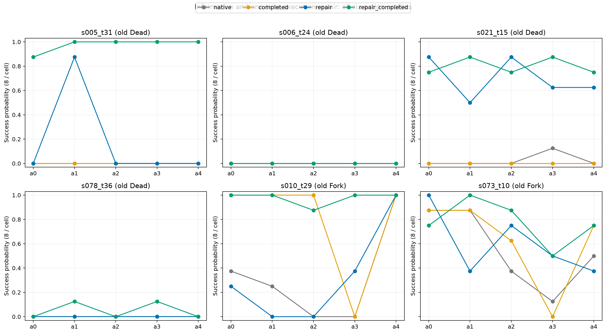

# 当前动作的信用可以被后续障碍遮住：信息 × 执行修复实验

2026-10-29，冻结后 exploratory。**已完成 480 条新续跑，复用 480 条原始对照，共 960 条。**
全部六个预定案例、五个原动作、四条件、每格八次均完整。正式运行计时 **649.6 秒，约 10.8 分钟**；
生成 8,355 个模型决策、1,112,433 tokens。没有训练模型，没有根据结果扩量。

**独立判断：原研究主线可以继续，而且有了比“哪些特征预测三域”更深的实验证据。**
当前动作的信息价值能被后续共同障碍遮住；解除障碍以后，原先看起来没有动作效果的位置，
会出现明显的动作差异。随后把信息共同补齐，这个差异又可以缩小。
另一个案例展示相反方向：补信息后剩下的分支差异，确实能通过修复该分支的执行障碍补回。

不过，**完整的“无成功 → 信息分叉显现 → 高成功率且差异缩小”路径，六个案例中只有一个特别清楚。**
其余结果不是都符合一个模板。本实验支持机制存在及其条件，不估计其普遍发生率，
也没有用新小样本重写原 Dead / Indifferent / Fork 标签。

用户曾取消关机，随后再次明确要求关机。GPU 任务已结束；完成本次上传后关机，另设最多三分钟的关机兜底。

## 1. 实验到底改变了什么

六个点来自此前已经写好的机制实验草案：四个原 Dead（s005、s006、s021、s078），
两个原 Fork（s010、s073）。均为有目的选择的障碍案例，不是随机总体样本。

| 条件 | 给位置线索 | 解除原有持物障碍 | 数据来源 |
|---|---|---|---|
| 原始 | 否 | 否 | 原五臂实验每格前 8 次 |
| 只补信息 | 是 | 否 | 同上 |
| 只修复 | 否 | 是 | 本轮新增 |
| 信息＋修复 | 是 | 是 | 本轮新增 |

修复只有一个操作：对原动作后已经持有的、任务目标类别以外的物品，
在第一次存在合法放置动作时，执行字典序第一条合法放置命令，随后交还原模型。
不替模型寻找目标、导航、打开容器，也不反复修复。放置占原 50 步预算中的真实一步。

CPU 检查发现 30 条分支中 22 条持有无关物品，14 条立即可以放下；其余 8 条需等待合法放置机会。
因此在看到本轮结果前，将草案中的修复明确为“第一次合法机会”，而不是要求立即放下。
另有 8 条分支本来没有此障碍，修复规则不触发。

位置线索仍在原动作之后只呈现一次，**先于修复**，按原两轮历史自然移出。
修复的环境响应、时间消耗和历史变化都真实保留；不能将其解释成完全隔离文本影响的物理干预。
模型、温度、回复格式与解析、总步数均沿用原实验。

新续跑使用独立种子命名空间；两个修复条件在相同绝对步共享种子。
旧对照保留原种子，因此没有声称新旧两批是完全配对随机数实验。
原始文件、标签与冻结结果未修改。

协议：[PROTOCOL.md](../exploratory_deep_discovery/execution_factorial_2026_10_29/PROTOCOL.md)。
实现、检查与复现：[README.md](../exploratory_deep_discovery/execution_factorial_2026_10_29/README.md)。

## 2. 六个案例的完整结果

表中是五个原动作均匀平均的终局成功率，并非整套新策略在测试集上的成功率。

| 决策点／任务 | 原始 | 只补信息 | 只修复 | 信息＋修复 | 实质含义 |
|---|---:|---:|---:|---:|---|
| s005_t31：钢笔放到桌上 | 0% | 0% | 17.5% | **97.5%** | 共同障碍遮住信息差；修复后信息变得关键 |
| s006_t24：台灯下看闹钟 | 0% | 0% | 0% | 0% | 局部拾取恢复，后续任务执行仍失败 |
| s021_t15：冷却酒瓶再放置 | 2.5% | 0% | **70%** | 80% | 主要是共同执行障碍；不要求先出现明显分叉 |
| s078_t36：加热土豆再放置 | 0% | 0% | 0% | 5% | 拾取改善远大于终局改善，仍有后续操作／预算障碍 |
| s010_t29：雕像放到梳妆台 | 32.5% | 80% | 32.5% | **97.5%** | 补信息后留下的失败分支可由执行修复补回 |
| s073_t10：清洗餐刀再放置 | 55% | 62.5% | 60% | 77.5% | 修复有帮助，但没有完全抹平分支差异 |

每格仅 8 次。小幅差值不强行归因。全部动作的原始成功次数与比例在
[cells.csv](../exploratory_deep_discovery/execution_factorial_2026_10_29/results/cells.csv)。



### 2.1 最强证据：同一个位置的动作差异先出现，再缩小

**s005_t31**：任务是把钢笔放到桌上，但原前缀已拿着一支铅笔。
五个动作依次是：查看桌子、去边桌、去抽屉、去柜子、查看背包。
钢笔在边桌上；第二个动作直接显示它的位置。

| 条件 | 五臂成功率 | 去噪动作方差 C |
|---|---|---:|
| 原始 | `[0, 0, 0, 0, 0]` | 0 |
| 只补信息 | `[0, 0, 0, 0, 0]` | 0 |
| 只修复 | `[0, .875, 0, 0, 0]` | .120 |
| 信息＋修复 | `[.875, 1, 1, 1, 1]` | 约 0 |

**它不是“多给一点帮助，成功率就高一点”。** 信息单独增加的平均终局收益是 0；
在有修复时，信息增加的平均收益是 80 个百分点。其信息×修复交互为 +80 pp。

原模型无法稳定释放错误物品时，知道钢笔在哪里不足以完成任务，所以五个动作看起来都没收益。
只修复这个共同障碍以后，直接看到钢笔的动作成为唯一高成功率分支。
再给其余分支同一条位置线索，它们也能成功。

这直接支持：**一次决策的信息价值可能真实存在于环境机会中，却没有进入当前策略的终局信用。**
解除一个后续限制可以让它显现；共同补齐信息又可以减少该动作的相对必要性。

原始 `a1 / 信息＋修复 / r000` 轨迹：31 步到边桌，32 步放下铅笔，33 步拿钢笔，
34 步到桌子，36 步成功放置。除第 32 步外，全部后续动作由原模型生成。
[完整记录](../exploratory_deep_discovery/execution_factorial_2026_10_29/results/cases/s005_t31__a1__repair_completed__r000.json)。

这里描述的是连续结果结构，不把近乎全成功条件自动重新命名为 Indifferent。
原三域包含有限测量与常量结局的定义，不能仅凭这张小样本表宣布完成三个冻结标签的转换。

### 2.2 第二条关键证据：补信息留下的差异，确实来自可修复的分支障碍

**s010_t29**：把雕像放到梳妆台。五臂中第四个动作拿起了无关的铅笔。

| 条件 | 五臂成功率 | C |
|---|---|---:|
| 原始 | `[.375, .25, 0, 0, 1]` | .1243 |
| 只补信息 | `[1, 1, 1, 0, 1]` | .1600 |
| 只修复 | `[.25, 0, 0, .375, 1]` | .1257 |
| 信息＋修复 | `[1, 1, .875, 1, 1]` | 约 0 |

此前“信息提高平均收益，却放大五臂差异”的观察，现在有了针对性验证：
只补信息时，拿铅笔的分支仍为 **0/8**；再把铅笔放下，该分支变为 **8/8**。
只修复、不补位置时，该分支为 **3/8**。

这不是所有分支同时接受额外帮助造成的模糊解释：修复只在第四条分支触发。
其余四条分支没有原有持物障碍，修复规则不执行；新旧小幅差异来自重新采样，不能算修复效果。

`a3 / 信息＋修复 / r000`：29 步拿铅笔，30 步放回，31 步去书架，32 步拿雕像，
34 步完成放置。[完整记录](../exploratory_deep_discovery/execution_factorial_2026_10_29/results/cases/s010_t29__a3__repair_completed__r000.json)。

**两个案例合起来，区别于简单的“执行能力越好，当前动作越不重要”：**
修复共同障碍可以显露分叉，修复分支特有障碍可以补平分叉。方向取决于障碍如何分布在动作分支中。

### 2.3 其余案例给出的边界

**s021_t15：共同障碍可以主要影响价值，而不制造明显动作差异。**
只修复后的五臂为 `[.875, .5, .875, .625, .625]`，均值 70%；
信息＋修复为 `[.75, .875, .75, .875, .75]`，均值 80%。
去噪 C 分别约为 0 和 −.01286；负数是小样本无偏估计，不是真实负方差。
这个点支持执行障碍压低全部分支，但不支持“所有 Dead 修复后都先成为 Fork”。

**s006_t24：释放持物并真实拿到目标，仍不足以获得奖励。**
原始与只补信息均未拿到线索指定的闹钟；只修复后的该闹钟实际拾取率为 27.5%，
信息＋修复后达 **85%**，终局成功率依然为 0。
固定案例中第 27 步拿到闹钟，此后反复查看桌子和闹钟，未完成台灯下查看任务。
[原始失败记录](../exploratory_deep_discovery/execution_factorial_2026_10_29/results/cases/s006_t24__a4__repair_completed__r000.json)。
因此负结果并非简单的“线索没被用到”或“修复没执行”，后面还有未解决的环节。

**s078_t36：目标获取恢复，后续操作与剩余步数仍限制终局收益。**
信息＋修复后，线索指定土豆的实际拾取率达到 **90%**，成功率仅 5%。
固定案例先把未加热的土豆放到垃圾桶，随后改拿另一只土豆，直到第 50 步才完成加热，无法再放置。
[原始失败记录](../exploratory_deep_discovery/execution_factorial_2026_10_29/results/cases/s078_t36__a1__repair_completed__r000.json)。
拾取指标只统计线索指定实例，不将其误称为所有目标实例的完整中介变量。

**s073_t10：部分修复，不是完美闭环。**
拿起肥皂瓶的第四条分支，在只补信息时为 0/8，信息＋修复后为 4/8；
只修复也为 4/8，因此这个分支本身不显示额外信息与修复的强互补。
完整五臂 C 从只补信息时 .0943 降到二者同时 .0114，但不能借此夸大两种干预在此点的协同。

## 3. 怎样反哺原来的三域与信息损失直觉

原 Phase 3 的测量没有失效。它测量的是：**在当前后续策略、候选动作和预算下，
终局结果能否区分这些动作，以及什么信息能够预测这种区分。**

新的机制实验补充了它之前没有回答的部分：为什么有些信息差进入了终局信用，有些没有。

1. **终局信用是条件性的。** 当前策略后面共同失败时，动作产生的信息机会可能没有兑现。
   此时增加同一策略的 Monte Carlo 次数，可以更准确地估计低成功率，却不会自动揭示换一种后续执行方式后才出现的动作差异。
2. **一步反馈描述的是局部机会，不保证机会兑现。** 在 s005，能看见钢笔的响应只有在释放持物障碍后才对应高终局收益。
   在 s006/s078，已经真实拿到目标，仍然无法稳定完成任务。这解释了 W1 有预测力却不是充分条件。
3. **动作差异的来源可以迁移。** s010 中，补位置后主要剩下持物分支的障碍；再修复它，差距缩小。
   因而不能把某个位置的 Fork 当作一个固定、单一来源的“重要性”。
4. **不同信息源观察不同部分。** 兄弟轨迹可以反映当前策略的共同成功／失败机会；
   一步反馈更接近动作后机会的差别。这是与 Phase 3 的一致机制解释，
   本轮没有重新检验 G 的全部作用机制，也没有独立证明所有 Indifferent 都来自某种补偿。

所以原始“信息丢失”直觉可以升级为：

> 有些动作相关的信息不只是被轨迹日志丢掉了；它在当前后续执行条件下，根本没有转化为终局回报的差异。

两者需要区别：本轮支持后者在特定案例中存在，不证明所有低信用都源于它。

## 4. 可以抽象成什么，不应包装成什么

用 `q_a^{i,e}` 表示原动作 a 在信息条件 i、执行修复条件 e 下的成功率。
继续保留 `mu=mean_a(q_a)` 与 `C=Var_a(q_a)`，分别描述整体机会与动作间差异。

对于某项干预带来的逐臂收益 `d_a`，有旧恒等式：

```
C_after - C_before = 2 Cov_a(q_before, d) + Var_a(d)
```

它不是新理论。真正的实测内容是：**相同类型的执行修复，因为作用在共同障碍或分支障碍上，
可以让动作差异向不同方向变化。** s005 的首次修复显露信息分叉；s010 在补信息后修复剩余分支，缩小分叉。

也不能把本轮称作“信息与执行已被完全因果分解”。修复是一个带真实时间与历史后果的辅助 continuation policy；
只有六个预选点，完整显露路径主要来自一个点。我们识别的是具体干预的效果及可观察行为链，
不是所有长程 Agent 的唯一生成机制。

## 5. 对论文与 OPSD 的明确判断

**值得继续的主故事：当前策略观察到的信用，取决于它能否兑现动作创造的机会。**
三域作为测量地图，Phase 3 作为信息定位实验，信息干预作为机会证据，本轮因子实验解释障碍如何遮住或留下差异。
“Siblings Find the Dead, Peeks Find the Fork”可以作为这个更大问题中的经验结果，没必要丢掉。

候选标题：**When Does an Action Matter? Information and Execution Bottlenecks in Long-Horizon Agents**。

最有辨识度的图应同时画 s005 与 s010 的四条件完整五臂向量，再放入 s006 的“拾取提高、奖励仍零”作为边界。
不要只放平均成功率图，也不要用新的分类器 AUROC 充当机制验证。

**当前仍不足的证据：** 一个特别清楚的共同障碍案例不能代表 ALFWorld 总体，两个分支障碍点也不是跨环境规律。
下一次最值得投入的是固定规则选出的少量独立案例复现同一交互，并在另一环境寻找对应的后续执行门槛。
这比继续增加熵特征或微调 Teacher 提示更接近核心问题。本轮按约定结束，不启动这些任务。

对 OPSD 的启示是：当前学生的零终局优势，未必意味着该经历没有可教学的局部能力；
修复一个下游必要能力以后，上游动作偏好可能重新显现。
但本轮没有训练任何模型，强制放下物品不等于学生已经学会。
**它支持重新思考监督应服务哪一个执行环节；尚不支持某个具体 OPSD 算法有效。**

之前真实 Hindsight Teacher 探针未支持“知道更多就系统性抹掉有用偏好”的强假说，
本轮也不试图恢复它。两条证据分别报告，见
[Teacher 实测报告](teacher_probe_results_2026-10-29.md)。

## 6. 检查、成本与可复查材料

- 全部 960 条记录逐条检查来源、完成状态、动作、重复编号、单次线索、最多一次修复及步数上限；全部通过。
- 22 条有障碍分支 × 2 条件 × 8 次共 352 个可触发记录，实际修复 **350** 次；另外两条因模型始终未走到合法放置机会而未触发。
- 8 条无初始障碍分支中没有强制修复。其原始／新采样均值差为 −6.25 pp，无修复／有修复但带线索的差为 +1.5625 pp；
  这些是重新采样波动，不应据小幅五臂变化推断额外机制。
- 新测量共 8,355 个模型动作、350 个修复动作、480 个原始强制动作；另有恢复历史所需的环境动作。
  正式运行计时 649.6 秒，包括启动；CPU 检查、分析和上传不包含在其中。
- 方差沿用不同 repeat 的交叉乘积无偏估计，不把负估计裁成零。六个目的性样本的组区间保存在 JSON，
  不将其当成总体随机抽样置信度，也不以是否显著决定增加样本。

原始逐条结果：[records.csv](../exploratory_deep_discovery/execution_factorial_2026_10_29/results/records.csv)。
全部统计：[summary.json](../exploratory_deep_discovery/execution_factorial_2026_10_29/results/summary.json)。
完整性与来源哈希：[integrity.json](../exploratory_deep_discovery/execution_factorial_2026_10_29/results/integrity.json)。
**全部 960 条原始续跑**（包括明确复用的对照）：
[压缩档案](../exploratory_deep_discovery/execution_factorial_2026_10_29/results/all_960_continuations.tar.gz)。
六点固定诊断臂、四条件、重复 0 的原始案例：
[case_index.json](../exploratory_deep_discovery/execution_factorial_2026_10_29/results/case_index.json)。

最终结论：**这轮让“原来的故事还能不能继续”从一个解释性猜测，变成了有明确干预支持的方向；
它还不是已证的普遍规律，但已经值得围绕“机会何时进入终局信用”继续深化。**
