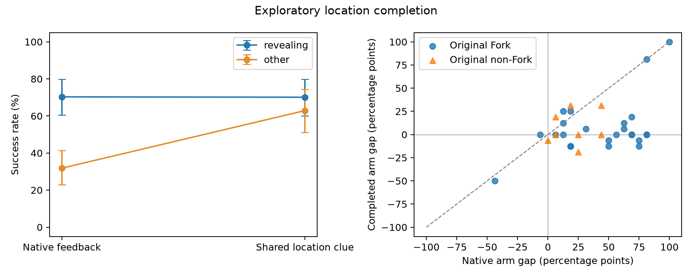

# 补齐目标位置线索：2048 条续跑的机制实验结果

2026-10-28。冻结后 exploratory 实验；原始数据、冻结标签、主结果不变。

**主要结果：在预先选定的 24 个原 Fork 点上，只给两条分支补上同一条真实目标位置线索，成功率差距就从 44.3 个百分点降到 7.3 个百分点。原来没有显示目标的分支提高 38.3 个百分点；已经显示目标的分支基本不变。**

这支持一个具体机制：这批信息型动作对的长期差异，有相当一部分来自可以通过反馈补回的信息优势。它不是“原来较好的分支被干扰变差”造成的假收敛。

## 1. 实际做了什么

- 32 个不同任务，覆盖六类 ALFWorld 任务；24 个原 Fork、8 个原 Live 未检出 Fork。
- 每点固定两个动作：一个 peek 显示目标位置（revealing），另一个没有显示目标（other）。动作方向不按成功率定义。
- native 保持真实反馈；completed 在强制动作后追加同一条真实位置线索，例如 `Additional location information: cellphone 1 is at bed 1.`。
- 两条分支都追加这条线索；只追加一次，随后遵循原来的两轮记忆规则。实际位置、持物状态、合法动作与剩余步数不改。
- 每点 2 动作 × 2 条件 × 16 次，总计 **2048 条**。使用新的种子区间，native/completed 采用配对随机数。
- 目标实例此前未在 factual 历史（含合法动作）中出现。线索来自已有 peek 文本，facts 只验证它在两条分支中都为真。选点在原标签层内进行，不读取动作成功率或 Gold 来挑选动作对。

样本：[设计文件](../exploratory_deep_discovery/opportunity_completion/design.json)、[全部案例](../exploratory_deep_discovery/opportunity_completion/design.md)。这是信息型、富集 Fork 的机制样本，不代表全部 ALFWorld 决策点。原“非 Fork”只表示原协议未检出，不是零效应真值。

## 2. 主要结果

### 预定主分析：24 个原 Fork 点

| 分支 | 原始反馈成功率 | 补齐线索成功率 | 变化 |
|---|---:|---:|---:|
| 本来就显示目标的动作 | 75.8% | 77.1% | +1.3 pp，95% CI [-2.9, 6.0] |
| 原来未显示目标的动作 | 31.5% | 69.8% | **+38.3 pp，95% CI [25.0, 51.6]** |
| 两动作之差 | **44.3 pp** | **7.3 pp** | **缩小 37.0 pp，95% CI [24.2, 49.7]** |

原始差距 CI [29.9, 57.0] pp；补齐后差距 CI [-3.4, 20.1] pp。后者区间包含零，不能据此声称所有剩余差异都消失。

### 全部点与原未检出点

| 人群 | n | 原始差距 | 补齐后差距 | 差距缩小 | other 分支增益 |
|---|---:|---:|---:|---:|---:|
| 全部 | 32 | 38.5 pp | 7.2 pp | 31.2 pp [20.7, 42.6] | 31.1 pp [19.9, 42.4] |
| 原 Fork | 24 | 44.3 pp | 7.3 pp | 37.0 pp [24.2, 49.7] | 38.3 pp [25.0, 51.6] |
| 原 Live 未检出 Fork | 8 | 21.1 pp | 7.0 pp | 14.1 pp [0.0, 28.9] | 9.4 pp [-1.6, 19.5] |

区间按任务 bootstrap，点内四条件保持配对。全部 32 点中 other 分支的样本增益：26 点为正、3 点为零、3 点为负；负结果全部保留。

在原 Fork 层，other 分支在后续三步内**尝试拿取该目标实例**的比例提高 58.1 pp [44.0, 71.6]。这是动作字符串标记，不等于所有尝试都实际拿取成功；主终点始终是环境判定的最终成功。



左图展示全部 32 点；预定主分析的 24 个原 Fork 数字见上表。

## 3. 真实案例：信息如何改变后续执行

### 补回线索后直接完成任务：s026/t35

任务：把手机放进 dresser。revealing 为 `go to bed 1`，other 为 `go to drawer 2`。线索是手机在 `bed 1`。

- revealing：原始 15/16 成功，补齐后 16/16。
- other：原始 **2/16** 成功，补齐后 **16/16**。
- 补齐后的 other 分支，16/16 次下一步都是 `go to bed 1`。

同一重复编号 0：原始 other 在空抽屉、dresser 之间继续搜索并失败；补齐后依次执行：

```
go to bed 1
take cellphone 1 from bed 1
go to dresser 1
move cellphone 1 to dresser 1
```

在第 39 步成功。干预没有把 Agent 直接移动到床边，也没有替它拿手机。

原始记录：[native](../exploratory_deep_discovery/opportunity_completion/runs/main_32x16/results/s026_t35__other__native__r000.json)、[completed](../exploratory_deep_discovery/opportunity_completion/runs/main_32x16/results/s026_t35__other__completed__r000.json)。此例用于展示行为链，不代替总体效应估计。

### 知道位置仍补不回：两个拿着错误物品的分支

最大的两个剩余正差距是：

| 点 | other 强制动作 | 目标 | 补齐后 revealing / other 成功数 |
|---|---|---|---:|
| s010/t29 | 拿起 pencil 1 | statue 1 | 16/16 对 0/16 |
| s021/t08 | 拿起 apple 2 | winebottle 1 | 13/16 对 0/16 |

s010/t29 补齐后，16/16 次都立即前往正确的 shelf，但仍全部失败。这不是没有读取线索。

对这两个案例做了额外的 **CPU 环境核对，没有新增 LLM 续跑**：拿着错误物品到达目标所在位置后，目标确实可见，但 `take target` 不在合法动作中；把错误物品放下之后，`take target` 随即成为合法动作。

因此，它们存在一个可观察的额外执行障碍：信息到手以后，还需要释放持物资源。这个障碍可恢复，不能称为物理“必死”；本轮 Agent 没有成功完成恢复。

核对结果：[physical boundary checks](../exploratory_deep_discovery/opportunity_completion/runs/main_32x16/exploratory_physical_boundary_checks.json)。原始案例：[s010 completed](../exploratory_deep_discovery/opportunity_completion/runs/main_32x16/results/s010_t29__other__completed__r000.json)、[s021 completed](../exploratory_deep_discovery/opportunity_completion/runs/main_32x16/results/s021_t08__other__completed__r000.json)。这是看完主结果后的机制解释，不删除这两个点、不重算一个更漂亮的主结果，也不宣称已解释所有残余。

### 信息被使用，也不保证完成后续要求：s001/t17

任务要求冷却 winebottle 后放入 garbagecan。other 分支补齐位置后，三步内尝试拿取目标的次数从 0/16 到 15/16，但最终成功只从 3/16 到 5/16。位置搜索已经大幅改善，后续冷却与正确放置仍是障碍。

这提供了一个具体边界：一步线索可以改变后续行为，收益大小还取决于后续执行。不能将“线索出现”“Agent 使用线索”“任务最终成功”合并成同一个事件。

## 4. 对论文故事意味着什么

**当前最扎实的新增命题：在这些原本缺少目标位置信息的动作对中，部分长期动作优势可以被一次短反馈干预补回。**

这把已有 W1 的预测关联推进了一步：真实世界与原动作保留，只增加局部信息，原来较弱的分支显著变好，而已经看到目标的分支总体基本不变。

同时，两个持物受限案例解释了为什么同样的线索并不总能抹平差异：它补充的是信息，没有自动恢复可执行操作或补齐后续策略能力。可以沿原论文主线讲“当前动作留下了怎样的机会差；哪些差异可以通过短反馈补回，哪些仍依赖实际执行”。无需另开记忆论文。

本实验尚未证明最强的日志估计器一定无法预测这些差异，也不能把 37 pp 推广成所有 Fork 的平均效应。位置、开关状态等可以在两动作之间不同；本实验识别的是固定各动作后追加线索的效果，不是完整的因果中介比例。

现在已有足够明显的第一轮机制结果，不建议马上扩大为大量遮蔽或记忆消融。先将本结果接入原来的 W1、Masked 与动作对应关系证据链，再决定跨环境要验证的最小对象。

## 5. 文件与运行记录

- [完整汇总](../exploratory_deep_discovery/opportunity_completion/runs/main_32x16/summary.md)
- [汇总 JSON 与区间](../exploratory_deep_discovery/opportunity_completion/runs/main_32x16/summary.json)
- [逐点四格结果](../exploratory_deep_discovery/opportunity_completion/runs/main_32x16/summary_points.csv)
- [逐次配对结局](../exploratory_deep_discovery/opportunity_completion/runs/main_32x16/summary_paired_outcomes.csv)
- [运行说明与代码入口](../exploratory_deep_discovery/opportunity_completion/README.md)
- [GPU 与软件环境](../exploratory_deep_discovery/opportunity_completion/runs/main_32x16/launch_environment.json)

正式运行耗时约 **61.6 分钟**，42,759 次模型生成决策，5,845,637 个输出 token；另有 16 条 GPU smoke。GPU 为 RTX PRO 6000 Blackwell 96 GB。运行使用 Qwen2.5-7B、T=0.7、50 步上限、两轮历史；vLLM 0.32.0、torch 2.13.0。

完整性核对：2048 条记录，128 个点—动作—条件单元，每单元 16 次；全部符合条件标记和步数上限。原始输入哈希未变化。GPU 推理进程已退出，核对时显存占用为 0 MiB。
