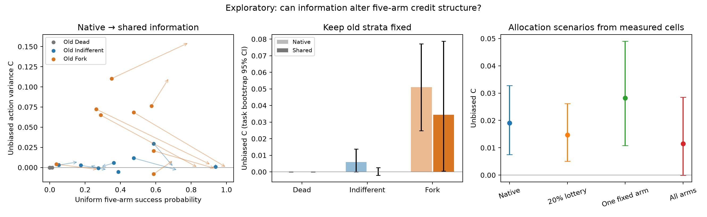
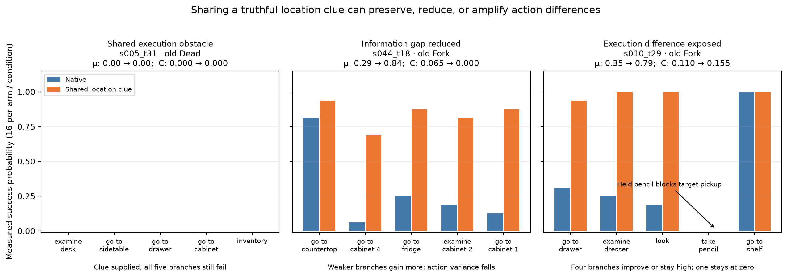

# 从三域分类到三域形成机制：五臂信息干预

2026-10-28。冻结后 exploratory。**已完成：24 个不同任务、原五臂、两条件、每格 16 次，共 3840 条记录；
其中 2816 条新增、1024 条明确复用。正式 GPU 运行约 81 分钟，GPU 已释放。**
不修改原 Phase 3 标签、判定、原始结果，也不覆盖既有报告。

本轮最有价值的结果是：信息补齐显著帮助原 Fork 中未显示线索的分支，但对完整五臂信用结构的作用有不同方向。
有的分支差距被补平，有的剩余执行障碍更加突出。**“信息是否有用”与“当前动作是否仍有差异”需要分开回答。**
完整五臂的平均方差降幅区间跨零；本报告不把普遍消除 Fork 当成已证结论。

## 1. 本轮研究问题

原来的“信息损失”适合作为研究起点，但不足以独立承担论文贡献。三域也不能仅停留在
Dead / Indifferent / Fork 的比例表。本轮沿原实验主线追问：**哪些局部条件使候选动作具有不同的长期收益，
改变这些条件以后，平均成功机会与动作间差异是否会向不同方向变化？**

原 Phase 3 先用回放定义信用结构，再比较信息源定位边界的能力。一步反馈表现较好，且目标揭示特征贡献很大。
上一轮两臂干预已经说明，在选定的信息型动作对中，一条真实位置线索能显著补回较弱分支的收益。
本轮把同一干预扩展到原来的全部五个候选动作，以便直接研究三域依赖的动作结果结构。

这是信息型 Fork 的机制研究，不预设所有 Fork 都来自信息；也不把旧 Dead 理解成物理上不可恢复。

## 2. 一个可测量的机制结构

在固定前缀、原五臂集合、原 continuation policy 与步数预算下，令：

\[
q_a=P(R=1\mid a),\qquad \mu=\frac15\sum_a q_a,\qquad C=\operatorname{Var}_a(q_a).
\]

`mu` 衡量五臂均匀参考下的成功机会，`C` 衡量当前动作选择造成的期望差异。
二者不是同一个对象。恒定结局、结局波动但动作差异小、存在动作差异，是原三域的连续量背景。
有限预算下仍然使用原标签作为固定分层，不将未检出差异当成真零。

补齐信息后令 `d_a=q_a^completed-q_a^native`。有恒等式：

\[
C_{completed}-C_{native}
=2\operatorname{Cov}_a(q_a^{native},d_a)+\operatorname{Var}_a(d_a).
\]

**恒等式不是新理论。经验问题是信息的收益落在哪些分支。** 若主要帮助原来较弱的动作，负协方差项
足够大，整体成功率就能上升而动作差异下降。但只帮助一部分较弱动作、留下一条无法获益的分支，
也可能放大动作差异：增益自身的不均匀性可能超过负协方差的抵消。
所以“给信息就一定消除 Fork”不是我们的假说。

所有二次量用不同 continuation repeat 的交叉乘积估计，去除同一批有限结果造成的噪声项。
这对 `Cov(q_native, lift)` 特别重要：直接用同一批样本均值相减，会人为制造“低基线、高增益”。
代码保留负的无偏估计，不把它们截成零。区间按任务重采样。

## 3. 已完成：重分析原两臂实验

输入为上一轮完整 2048 条实际续跑，32 个不同任务；其中 24 个原 Fork、8 个原 Live 非 Fork。
这一步仍然只研究两个受测动作，不能冒充五臂三域转换。

| 原分层 | n | 原 C | 补信息后 C | C 降幅及 95% CI | 两臂平均成功率增益 |
|---|---:|---:|---:|---:|---:|
| 全部 | 32 | 0.05885 | 0.01549 | 0.04336 [0.02383, 0.06315] | +15.43 pp |
| 原 Fork | 24 | 0.07457 | 0.01953 | 0.05503 [0.03134, 0.07952] | +19.79 pp |
| 原非 Fork | 8 | 0.01172 | 0.00339 | 0.00833 [-0.00339, 0.02266] | +2.34 pp |

在原 Fork 组，`Cov(q_native, lift)=-0.05434`，95% CI [-0.07960, -0.03055]。
它与增益自身的动作方差 0.05365 合起来，解释了 C 的降低。这里不是有符号差距的正负抵消：
直接针对动作方差的去噪估计也下降。

已有证据支持：在这批动作对中，位置线索的收益主要落在原来较弱的分支，
从而提高平均成功机会并减少当前动作的相对重要性。范围仍限于已选择的两臂信息案例。

输入记录哈希：[existing_pair_inputs.json](../exploratory_deep_discovery/regime_mechanism_2026_10_28/existing_pair_inputs.json)。
脚本：[analyze_existing_pairs.py](../exploratory_deep_discovery/regime_mechanism_2026_10_28/analyze_existing_pairs.py)。
数值：[existing_pair_analysis.json](../exploratory_deep_discovery/regime_mechanism_2026_10_28/existing_pair_analysis.json)。

## 4. 已完成：原三域中的目标反馈并不充分

对原 3038 个 cf-defined 点直接交叉统计，未拟合新分类器：

| 原域 | 点数 | 任一动作反馈提及目标 | 任一反馈提及全历史未见的目标实例 |
|---|---:|---:|---:|
| Dead | 1560 | 47.1% | 8.1% |
| Indifferent | 1003 | 53.5% | 14.4% |
| Fork | 475 | 84.2% | 40.4% |

因此，“某个动作看到了目标”并不是 Fork 的充分条件。原来的 OR bit 可以有效预测，但机制解释必须进一步
考虑哪些动作获得信息、信息能否被后续执行使用，以及尚存的物理或任务条件。
这些总体比例只是描述性背景，不控制任务、进度或价值混杂。

已核对实际实现：`scripts/27_features_W1.py` 中的 `target_revealed` 只是五条反馈是否有任一条提及目标实例，
没有检查它是否首次出现。因此特征名不能直接被解释为“获得了新知识”。
本轮研究的是位置线索在各分支中变得可用的影响；新信息、提醒与显著性没有被单独的安慰剂条件完全拆开。

脚本与表：[population_context.py](../exploratory_deep_discovery/regime_mechanism_2026_10_28/population_context.py)、
[population_context.json](../exploratory_deep_discovery/regime_mechanism_2026_10_28/population_context.json)。

## 5. 新增实验：直接改变五臂信用结构

固定设计为 24 个不同任务，原 Fork / Indifferent / 全失败 Dead 各 8 个。
每点保留原 factual + 4 alternatives；每臂 native / completed 各 16 次。
总共 3840 条，其中 1024 条直接复用上一轮相同协议的原始记录，实际新增 2816 条，另有 10 条 GPU smoke。
16 个旧点根据原分层、任务类型和固定哈希选择，没有按已观察到的干预增益挑选。
8 个 Dead 点根据旧标签和 peek 线索资格选取，并保留至少 10 步后续预算。
这是对已经审阅过的两臂样本的探索性扩展；选点要求能提取真实位置线索，各域结果不代表总体发生比例。

同一条线索在五个动作后都经真实环境验证为真。仅追加一次文本，物理状态、合法动作、总预算和策略保持原协议。
120/120 条分支通过 CPU preflight；数学估计与新种子隔离的 4 项测试通过；GPU smoke 的五臂十格通过。

**主分析**是原 Fork 层的五臂 C 变化和 mu 变化；另外两域及全部点完整报告。
同时用相同 16 次/臂预算绘制新的结局结构，但它们只是描述性 profile，不覆盖原双池冻结标签。

**附加的零额外回放比较：** 利用实测的逐臂 native/completed 单元，计算“只给固定一个动作线索”
与“所有动作均以 0.2 概率得到线索”的结果。二者在均匀五臂下有相同的期望线索注入频率。
这个比较检查信息与动作的对应如何影响 C；它是由实测单元构成的干预协议，不能包装成新的独立样本。
随机选择性分配产生方差的一部分是代数上的预期，本论文不将其宣称为新理论。

设计：[design.md](../exploratory_deep_discovery/regime_mechanism_2026_10_28/design.md)。
完整协议、运行命令和局限：[README.md](../exploratory_deep_discovery/regime_mechanism_2026_10_28/README.md)。

## 6. 五臂结果

全部 24 点 × 5 臂 × 2 条件 × 16 次已完成，未根据中途结果改变样本或追加回放。
以下成功率是五臂均匀平均，C 为去除有限重复噪声的动作方差。区间按 8 个不同任务/原分层重采样。

| 原冻结分层 | n | Native 成功率 | 共同补信息后 | 成功率增益及 95% CI（百分点） | Native C | 补信息后 C | C 降幅及 95% CI |
|---|---:|---:|---:|---|---:|---:|---|
| 全失败 Dead | 8 | 0.16% | 0.00% | -0.16 [-0.47, 0.00] | ≈0 | 0 | ≈0 |
| Indifferent | 8 | 40.63% | 47.03% | +6.41 [-0.63, 13.59] | .00596 | .00004 | .00592 [-.00050, .01396] |
| Fork（主分析） | 8 | 39.53% | 76.56% | **+37.03 [23.75, 50.63]** | .05113 | .03438 | **.01675 [-.01404, .04709]** |

原 Fork 中，5 点 C 估计下降、3 点上升。平均降低约三分之一只是点估计，区间跨零，
**主分析没有确立完整五臂方差的平均下降**。这与旧两臂 C 的明确下降不矛盾：所测动作集合不同，
一对分支的差距不能代替整个候选集结构。三个上升点全部保留，包括下述两处明确持物障碍，以及
`s019_t09`（本轮 native 与补信息条件都未检出分叉，不给其小幅 C 变化强行归因）。

原 Dead 在 native 的 640 次中有 1 次成功，补信息后 640 次无成功；不能把这个差别解释为信息造成伤害，
也不能把旧 Dead 标签理解成数学上的成功概率为零。Indifferent 同样不是“信息必然无用”的类别，
例如 `s034_t13` 的平均成功率从 47.5% 升至 72.5%。

全部 24 点曲线：[summary_figure_all_profiles.png](../exploratory_deep_discovery/regime_mechanism_2026_10_28/results/summary_figure_all_profiles.png)。
完整逐臂数值：[summary_arms.csv](../exploratory_deep_discovery/regime_mechanism_2026_10_28/results/summary_arms.csv)。

### 6.1 已完成案例：同一干预的不同方向

这些是解释机制的事后案例，不用它们估计总体频率；全部点见上图链接。

**信息差距收缩：`s044_t18`，冷却酒瓶后放到餐桌。**
原五臂成功率为 `[.8125, .0625, .25, .1875, .125]`；共同补齐位置线索后为
`[.9375, .6875, .875, .8125, .875]`。均值提高 55 个百分点，去噪动作方差约从 .065 降至 0。
这里的信息主要补回了原来较弱分支的机会。

**执行差异被放大：`s010_t29`，把雕像放到梳妆台。**
原五臂为 `[.3125, .25, .1875, 0, 1]`，共同补信息后为 `[.9375, 1, 1, 0, 1]`。
均值提高 43.75 个百分点，动作方差却从 .1103 **上升**到 .1550。
始终为零的动作是“拿起铅笔”。它占用了持物位置，后续策略没有正确释放，无法拿雕像。
这不是信息完全无效：三条分支得到很大收益；只是最后的执行障碍变得更加突出。

更直观地说，结构从“只有找到雕像的那条分支容易成功”，变成“四条分支都容易成功、只剩拿铅笔的分支失败”。
两边仍可被叫作 Fork，但剩余差异的来源不同。这里的“放大”特指均匀五臂方差；最大最小差值都为 1，
factual 动作相对实测最佳动作的差距还从 .6875 降到了 .0625。因此不能据此说当前选择变差了，
或它的实际策略改进价值必然增大。这是保持完整 q 向量、而不把 C 当作万能重要性指标的理由。

该点在原冻结数据中恰好也是 **Masked Fork**。本轮 native 的 factual-minus-five-arm-mean 为 -.0375，
很接近零，但完整分支向量显然包含强弱动作。这把新机制实验接回了原来的信用压缩问题；
这些样本均值本身不构成新的 B3 符号显著性结论。

因此，不能把 `C_native-C_completed` 一概叫作“信息解释的信用比例”。差值可能为负，
而信息仍然大幅改善多数动作。完整的动作增益向量比一个所谓的解释率更有意义。

**共同失败约束：`s005_t31`，把钢笔放到桌上。**
五臂在两条件下都是 0/16 成功。前缀已拿着铅笔；一条动作直接看到了钢笔、其余动作得到相同位置线索，
但这些分支都受持物与后续执行问题限制。这是“给了信息但未改善收益”的具体边界。

**信息确实被用了，但终局没有收益：`s003_t18`。**
任务要求把冷却过的锅放到炉灶上。`a0/completed/r000` 在第 19 步走向线索位置、第 21 步真实拿起锅，
随后反复搬放，并在第 34 步清洗锅，最终没有完成冷却目标。这个案例说明“收到信息”“据此行动”
和“兑现终局收益”不能互相替代。它是原始轨迹证据，不是对模型主观意图的推断。

### 6.2 CPU 环境验证：这些障碍是否不可逆？

根据持物元数据检查 7 条分支，全部满足：拿目标当前不合法，但放下手中物品后，拿目标变为合法。
其中 `s007_t25` 手中的第一支钢笔仍是任务需要的物品，不能笼统称为“错误物品”。

进一步对两条简单放置任务执行显式合法计划：

| 案例 | 原域与分支 | 后续合法动作数 | 完成时总步数 | 实际完成任务 |
|---|---|---:|---:|---|
| s005_t31 | Dead，a1 | 4 | 35/50 | 是 |
| s010_t29 | Fork，a3 | 5 | 34/50 | 是 |

这些是在真实环境中的**可恢复性存在证明**，不代表修复后 LLM 的成功率，更不是新策略评估。
它们足以排除这两个案例的“环境已经物理无解”解释；不能推广为所有 Dead 均可恢复。
持物障碍未被处理，也可能涉及短记忆下的状态遗忘。这里的“后续执行限制”包含当前策略与观测方式的限制，
不能据此把“缺信息”和“不会执行”当成已被彻底分开的固有能力，更不能说模型在其他提示与记忆配置下也做不到。

代码与逐步真实反馈：[inspect_affordance.py](../exploratory_deep_discovery/regime_mechanism_2026_10_28/inspect_affordance.py)、
[affordance_checks.json](../exploratory_deep_discovery/regime_mechanism_2026_10_28/affordance_checks.json)、
[scripted_recoverability.py](../exploratory_deep_discovery/regime_mechanism_2026_10_28/scripted_recoverability.py)、
[scripted_recoverability.json](../exploratory_deep_discovery/regime_mechanism_2026_10_28/scripted_recoverability.json)。

### 6.3 信息到达、实际行动与终局收益之间存在不同断点

从全部 3840 条真实轨迹提取行为事件。实际拾取要求环境确实返回 “You pick up ...”，
不能只看模型发出了 take 指令。“前三步”指原动作之后的前三个生成决策，覆盖一次提示在两轮历史中的直接可见窗口。

| 原域 | 下一步走向线索位置 | 前三步实际拿到线索物品 | 全程曾实际拿到线索物品 | 最终成功 |
|---|---:|---:|---:|---:|
| Dead | 3.3% → 58.0% | 3.8% → 12.3% | 11.7% → 20.0% | 0.16% → 0.00% |
| Indifferent | 1.7% → 52.7% | 12.3% → 44.4% | 49.1% → 59.5% | 40.6% → 47.0% |
| Fork | 2.0% → 60.9% | 19.7% → 73.4% | 50.6% → 91.4% | 39.5% → 76.6% |

三个原域都出现了很大的即时转向变化，但后续环节不同。这不是“Dead 没读提示、Fork 才读提示”的现象。
Dead 中部分信息已影响导航甚至真实拾取，却未形成终局收益；Indifferent 中早期拾取的增幅大于最终拾取的增幅，
与“主要提前取得、后面原本也有取得机会”的解释相符；Fork 中最终取得目标与成功都大幅增加。
这为“当前动作造成的局部机会，是否会被后续过程补回、阻断或兑现”提供了行为证据。
它不是已识别的中介分解：线索指向的具体物品实例不一定是任务唯一可用实例，也没有随机化拾取事件。

另一个事后对照按当前反馈是否已显示同一线索实例分组，先逐点平均，再跨任务平均：

| 原域 | 已显示线索分支的成功率增益 | 未显示线索分支的增益 | 后者减前者及 95% CI（百分点） |
|---|---:|---:|---|
| Dead | 0.00 pp | -0.20 pp | -0.20 [-0.59, 0.00] |
| Indifferent | -4.69 pp | +9.18 pp | +13.87 [-2.15, 28.13] |
| Fork | **+1.56 pp** | **+45.90 pp** | **+44.34 [28.13, 60.74]** |

这支持信息主要补回原本未显示线索的分支机会，也弱化了“任何多一句话都同样有效”的简单解释。
不过显示/未显示不是随机分配的动作类型，分支状态与基线成功率也不同；不能把此表当成纯内容与提醒效应的完整分离。

持物元数据分组完整保存在 `mechanism_points.csv`：16 点无手持其他实例，6 点所有臂手持其他实例，
2 点仅部分臂手持其他实例。后两点是 `s010_t29`、`s073_t10`，C 分别上升 .04467、.03500，CPU 均验证了拾取限制。
该分组不是“任务被卡住”的自动标签：例如 `s025_t31` 已拿着另一个合法的土豆实例。
不从这几个事后分组推断总体因果机制比例。

行为汇总：[behavior_summary.json](../exploratory_deep_discovery/regime_mechanism_2026_10_28/results/behavior_summary.json)。
对照定义与结果：[mechanism_summary.json](../exploratory_deep_discovery/regime_mechanism_2026_10_28/results/mechanism_summary.json)。
“拿到锅但仍失败”的原始案例：[s003_t18 a0 completed r000](../exploratory_deep_discovery/regime_mechanism_2026_10_28/results/cases/s003_t18__a0__completed__r000.json)。

### 6.4 相同期望信息频率，分配方式仍改变动作差异

以下不是新启动的两组实验，而是利用实测 native/completed 单元计算的反馈分配协议。
固定单臂的选择只用干预前元数据；未按干预效果挑选。均匀五臂下，单臂固定获得线索、
以及每臂独立以 .2 概率获得线索，都有 1/5 的期望注入频率。

| 分配协议（全部 24 点） | 平均成功率 | C |
|---|---:|---:|
| Native | 26.77% | .01903 |
| 每臂 20% 随机获得 | 29.66% | .01468 |
| 只给一个固定未显示线索的臂 | 30.73% | .02822 |
| 五臂都得到 | 41.20% | .01147 |

固定单臂相对随机分配，C 高 .01354，95% CI [.00444, .02427]；成功率高 1.07 pp，95% CI [.31, 1.89]。
在原 Fork 层，C 的对应差为 .03760 [.01661, .06020]。
因此，**在这组实测分支上，只比较信息的平均注入频率，不能确定信用结构；信息与动作的对应也起作用。**
这是有实际收益可兑现时的经验结果；“选择性给信息能制造差异”的代数可能性本身不是新理论。
这些派生协议与主结果共用同一批记录，不是独立复现，也不等同于真实策略分布下的等成本结论。

补充展示：本轮 16 次/臂的描述性检验在 native 检出 8 点 Fork，广播后检出 2 点，固定单臂分配检出 10 点。
这里的 8 点并不完全等于原冻结的 8 个 Fork；旧标签不变。未检出不证明动作完全等价，标签计数不能替代上述连续量结论。

### 6.5 实际成本与可复核性

正式新增 2816 条续跑，75,414 次生成决策、10,367,499 个生成 token、4861.7 秒。
另完成 10 条 GPU 管道 smoke。所有 240 个单元均为 16 次；复用的 1024 条保留原种子、轨迹与源哈希，
没有当作新增独立样本。校验通过：原输入未变化、干预位置正确、全部预算不超过 50 步、复用轨迹逐条相同。
GPU 进程已正常退出。

轻量结果目录：[results/](../exploratory_deep_discovery/regime_mechanism_2026_10_28/results/)。
校验：[integrity.json](../exploratory_deep_discovery/regime_mechanism_2026_10_28/results/integrity.json)。
代码、结果与本报告哈希：[bundle_manifest.json](../exploratory_deep_discovery/regime_mechanism_2026_10_28/results/bundle_manifest.json)。
完整原始续跑保存在 `exploratory_deep_discovery/regime_mechanism_2026_10_28/runs/main_24x16/results/`。

## 7. 与原论文及相邻工作的连接

三域描述固定协议下的信用结构；信息阶梯测量哪些来源能定位它；本轮干预测试一个能改变结构的机制。
这三步连起来，才能超出“有信息丢失”和“某特征 AUROC 高”的描述。

需要纠正一个容易滑过去的逻辑：**无限蒙特卡洛可以识别固定策略与候选集下的动作成功率，
不能据此说它永远无法恢复动作期望。** 它不能仅靠这一组成功率告诉我们差异的来源，
也不直接告诉我们换信息、换后续策略以后信用结构怎样变化。后两项需要干预。

同样，W1 包含动作执行后才产生的环境回应，不能把它全部叫作“原本前向过程已有、后来被日志压缩丢掉的信息”。
原直觉可以保留为动机；更扎实的对象是**识别不同信用结构需要哪些观测，以及这些观测所暴露的机制**。

沿着原主线，当前可形成以下证据链：

1. 终局结果波动不等于当前候选动作的效果差异；三域首先区分这两个对象。
2. G 与 W1 的作用不同，提示状态整体成功机会与动作分支差异需要不同信息。
3. 目标揭示是 W1 的一个预测标记，但 47.1% 的原 Dead 也有目标反馈，标记本身不是充分原因。
4. 相同真实信息注入原五条分支后，比较整个 q 向量，才能检查它是在弥补分支机会差，
   还是只改善部分分支、把另一个执行障碍凸显出来。
5. 真实环境的修复计划进一步区分策略失败与物理不可恢复。

第 2 点是原 Phase 3 的分工现象，第 4–5 点提供机制连接；本轮没有额外证明 G 的匹配或动作支持机制。
这些链条不能被压成“所有 Fork 都是信息差，所有 Dead 都是不会执行”。

最接近的工作包括：[Critical-State RL](https://arxiv.org/html/2609.24985v1) 已区分动作方差与后续噪声，并据此选择局部训练位置；
[CWGT](https://arxiv.org/abs/2608.19760) 已使用独立回放检验信用估计与分支恢复；
[ICA](https://arxiv.org/abs/2602.10863) 已将获得的信息单元用于步级奖励分配。
因此，三域名称、方差恒等式、“信息有用”或“信用依赖后续策略”均不足以作为独立的新理论。

本研究值得争取的增量是：在自然 Agent 候选分支中，找到能由一步反馈暴露的任务信息差；
通过固定动作集合与物理执行的反馈干预，检验这种差异如何改变整体成功机会和动作可区分性；
再将这一机制接回 Phase 3 的定位与有限回放预算问题。是否在 WebShop 成立，仍需同构实验，不能由本轮推断。

## 8. 只再做一项实验时的选择

优先做小规模 **“信息补齐 × 执行障碍解除”** 的 2×2 干预，检验共同执行障碍与分支执行障碍
是否对五臂结构产生不同作用。它直接延续本轮观察，比继续增加分类特征更可能提升论文深度。

最小设计六个机制点、五臂、每格八次，复用已有无修复条件，只新增 480 条续跑，预计 0.3–0.6 GPU 小时。
它尚未启动；完整触发规则、预期分歧、预算及失败时停止条件见
[next_decisive_experiment.md](../exploratory_deep_discovery/regime_mechanism_2026_10_28/next_decisive_experiment.md)。

## 9. 我的最终判断：怎样反哺三域，而不另开一篇论文

**最值得继续的命题是：当前动作带来的局部机会，只有在后续策略能够兑现、又没有被其他路径补回时，
才会形成明显的终局信用差异。信息在分支间怎样分配，以及剩余执行条件，都会改变这种差异。**
这是有数据支持的机制候选，还不是已证明覆盖整个 Agent RL 的一般定律。

它对三域的解释是有条件的：

- 共同的失败限制可以压住多条分支；局部信息改变了行为，终局仍几乎全失败。本轮 Dead 的轨迹提供这类证据。
- 后续过程若本来也有机会取得同一资源，当前动作带来的差别可能主要是时间提前，最终效果较小。
  Indifferent 的早期/最终拾取差异支持这一解释，但没有证明所有非 Fork 都来自恢复。
- 局部机会若能被利用、且原来较弱的分支在预算内难以补回，就会产生明显动作差异。
  原 Fork 中，未显示线索分支大幅获益、已显示线索分支基本不变，是本轮最强的组证据。
- 补平一种机会差以后，另一种限制可能留下甚至放大差异。这解释了为什么信息有效却不一定消除 Fork，
  以及为什么保持同一个三域标签不代表机制没变。

因此，原论文主干应当保留为 **三域结构 → 信息源分工 → 针对性干预解释结构 → 有限预算用途**。
“Siblings Find the Dead, Peeks Find the Fork” 可以保留为最醒目的经验现象；更深的科学问题是
**“一步世界回应暴露的机会，什么时候会成为终局信用？”** 初始信息损失直觉退到动机，
不必硬说前向置信度里曾经包含所有重要信息，只是后来丢失了。

题目方向可以是 *When Does Information Become Credit? World Feedback and Continuation Bottlenecks in LLM Agents*。
“Continuation bottlenecks” 指固定策略、记忆和预算下的限制，不是模型固有能力标签。

论文图的组织可以很集中：Figure 1 用完整 q 向量解释三域；Figure 2 保留 Phase 3 的信息阶梯与分工；
Figure 3 放本轮五臂干预、行为链与反向案例；Figure 4 用下一轮信息 × 修复实验检验条件交互；
Figure 5 连接原有预算分配结果，并在 WebShop 检验同一“机会—兑现—分支差异”对象。
Figure 4 的结果与跨环境结论目前尚未取得，不能提前画成正结果。

若只追加一项实验，我选择第 8 节的小型因子干预，而不是增加每点 Monte Carlo 次数。
最有辨识度的预测是：**共同执行限制解除后，原先不显现的信息差可能成为 Fork；再共同补齐信息，差异又缩小。
分支特有的执行限制则可能在补信息后更加突出，直到它也被解除。** 两种结果都用原五臂结构衡量，
能够直接检验三域怎样形成，而不是只展示一个 Agent 成功率提升。

现在不值得继续投入的是：寻找更多 entropy/importance 特征以提高小数点后的 AUROC、
为了让整体 C 降幅显著而机械扩样、把所有 Fork 都硬解释成信息差，以及立即做一个大型训练算法。
这轮已经找到值得定向验证的机制，也明确找到了单纯“信息均衡就消除 Fork”故事的边界。
要成为有竞争力的顶会机制论文，还需要小型因子干预闭环与跨环境同构证据；
24 个富集 ALFWorld 案例本身不足以宣称通用性，方差恒等式也不是创新所在。
