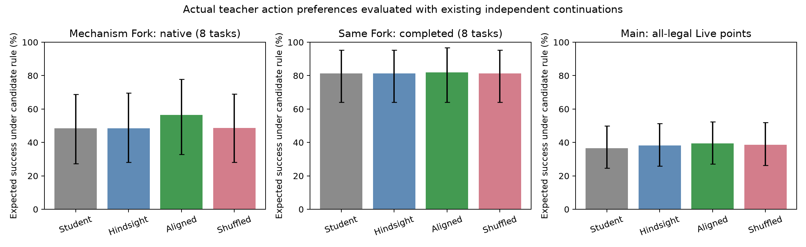

# 实际 Teacher 实验：信息条件错配假说没有得到支持

2026-10-29。单张 RTX PRO 6000 96GB，Qwen2.5-7B-Instruct。
**实际模型评分已全部完成；没有训练，没有新增环境续跑；GPU 已释放。**

## 1. 直接结论

本轮没有支持上一份备忘录中最强的假说——“Teacher 因为知道更多，抹去了原 Student 最需要学习的动作区别”。
普通 Hindsight 的建议没有表现出系统性的收益下降；额外明确给出真实位置线索，反而改善了部分原 Student 的建议。

正确对应的一步分支证据有一些正收益，但幅度小、集中于少数案例。它尚不足以支撑一套复杂的校正方法或大规模训练。
尤其不能用开发案例的 +8.1 pp 包装成广泛的机制复现：99.7% 的该组净增益来自雕像案例一个点。

**应该保留：** 信息干预改变动作收益结构；完整 factual 轨迹未必包含未执行分支的证据；动作—反馈对应有潜在教学价值。
**应该撤回作为主叙事：** 把补信息 continuation 的 Q 分布，当成真实 Hindsight Teacher 偏好的替身，再据此推断 Teacher 会失配。

## 2. 实验具体做了什么

使用之前已准备的固定样本：

- 开发机制集：24 个不同任务，旧 Dead / Indifferent / Fork 各 8；均有原五臂 native/completed 每格 16 次回放。
- 历史主集：120 点 / 50 任务，与开发任务隔离；其中 80 个 Live 点 / 33 任务可用独立第 5/6 库评价。
- 主集中的 63 个 Live 点 / 30 任务，其五个原候选均合法，单独报告。
- 主集 Gold 覆盖 22 点 / 16 任务，作第二结果读出。
- 40 个主集 Dead 没有独立第 5/6 库；只分析其 Teacher 行为，不补零。

主实验四种输入：

| 条件 | Teacher 可见内容 |
|---|---|
| S | 原 Student prompt |
| H | 原 prompt、完整 factual 轨迹、终局奖励 |
| A | H + 正确对应的五条动作—一步反馈 |
| X | A 的相同内容，但四个替代动作反馈做固定错配；factual 不变 |

H/A/X 使用相同的任务说明：为原 Student 选择能改善完成机会的动作，回看证据不自动注入 Student 的续跑。
完整轨迹包含每步原回复、已执行动作、反馈以及最终奖励，不只保留末尾摘要。
模型输入不包含 replay 成功率、三域标签、Gold、隐藏环境 facts 或补信息实验结果。

144 点 × 4 条件 × 5 候选，共 576 个上下文、2,880 个完整命令序列评分。
保留原 Student 已生成的实际思考前缀与动作起始格式，评分完整命令、结束标签及 EOS 的 log probability 和，
在候选集中归一化。使用 BF16 transformer、FP32 词表投影与 log-softmax。

以已有独立续跑 q 计算 J(p,q)=sum_a p(a)q(a)。它表示一次候选动作选择后的预期成功率，
不是训练后端到端成功率，也不是自由生成思考后的动作边际概率。
区间按任务聚类 bootstrap 4,000 次；实验属于探索性，历史选样使用过部分结果库。

## 3. 主集结果：Hindsight 没有系统性变差，反馈增量较小

### 第 5/6 库评价

| 条件 | 全部 Live：80 点 / 33 任务 | 原五候选均合法：63 点 / 30 任务 |
|---|---:|---:|
| S：原 Student 条件 | 37.12% | 36.56% |
| H：Hindsight | 38.45% | 38.27% |
| A：正确分支对应 | 39.12% | 39.40% |
| X：错配对应 | 38.41% | 38.59% |

主要配对差值（百分点）：

| 比较 | 80 个 Live 点 | 63 个全合法点 |
|---|---:|---:|
| H − S | +1.33 [-0.02, 3.99] | +1.71 [0.001, 5.12] |
| A − H | **+0.66 [-0.39, 2.02]** | **+1.13 [0.06, 2.72]** |
| A − X | +0.71 [0.07, 1.63] | +0.81 [0.01, 1.99] |

这不支持“完整 Hindsight 让原 Student 的动作建议普遍变差”。
正确对应相对错配有小幅正向信号；相对 H 的全部 Live 增量区间仍跨零。
全合法子集更好不能代替全部样本结果，两者均完整保留。

### Gold 与 Masked

Gold 22 点：S/H/A/X 分别为 34.20% / 38.15% / 40.25% / 38.98%。
A−H 为 +2.10 pp [-0.03, 5.54]，A−X 为 +1.27 pp [-0.13, 3.47]。
这是小样本的方向性支持，没有给出非常确定的大幅收益。

27 个主集 Masked 点上，A−H 为 **-0.58 pp [-2.29, 0.24]**。
已有 Masked 的真实改进机会，不等于本次 Teacher 已经能有效教出这些机会。

40 个主集 Fork 点，A−H +0.59 pp；40 个 Indifferent 点，A−H +0.73 pp。
本次增益没有清楚显示“主要集中于旧 Fork”，不能借原三域叙事预设路由有效。

## 4. 机制集：明显正例存在，但不是普遍现象

原 Fork 8 个任务：

| Teacher 条件 | 原 Student native 续跑评价 | 补信息 completed 续跑评价 |
|---|---:|---:|
| S | 48.44% | 81.25% |
| H | 48.43% | 81.25% |
| A | 56.54% | 81.99% |
| X | 48.60% | 81.27% |

A−H 在 native 为 +8.11 pp，但 **99.7% 的净增量来自 s010_t29**。
仅为检查集中性，去掉这个最大贡献点后的剩余七点平均为 +0.028 pp；该结果不取代完整组结果。

### 原始雕像案例：分支证据确实能够改变建议

`s010_t29` 的原 Student 决定继续搜抽屉，真实 factual 轨迹失败，也没有在环境观察中提到目标雕像。
在相同实际思考前缀后，Teacher 的候选概率为：

| 条件 | 去 drawer（原动作） | 去 shelf（发现雕像） |
|---|---:|---:|
| H | 约 100% | 约 0% |
| A | 5.9% | **94.1%** |
| X | 98.1% | 1.9% |

两动作 native 成功率分别为 31.25% 和 100%；A 相对 H 的该点建议价值提高 64.71 pp。

这个案例支持“未执行分支的真实证据可以提供完整 factual 轨迹没有提供的教学信息”。
它不支持“Teacher 原先知道太多而忽视搜索价值”：这里 H 的事实轨迹恰好没有看到目标。

### 主集正例与反例都保留

- `s035_t46`：任务是把闹钟放到桌上。A 将去 sidetable 的概率提高到约 49.3%，
  该动作在第 5/6 库为 6/6 成功；相对 H 的一次建议收益 +42.19 pp。
- `s027_t26`：冷却杯子并放到柜子。A 将较差动作 `go to cabinet 2` 的概率从约 3.1% 提到 40.2%，
  第 5/6 库价值从此受到损失，A−H 为 -18.53 pp。

全部主集的 A−H 去掉最大正贡献点后，只剩平均 +0.14 pp。
这些数值说明收益稀疏，也说明局部反馈不保证模型正确判断长期偏好。

## 5. 唯一补充对照：确保 Teacher 明确知道真实位置

这是查看完整主实验后增加的诊断，不与主实验混成预先固定的一组。
动机是：只有 4/8 个 Fork 的 factual 环境观察提及线索实例，Hindsight 不保证已经包含目标信息。

给全部 24 个开发点的 H 条件追加同一条先前验证为真的位置线索，称为 C。
明确说明事实只提供给 Teacher 作判断，不会额外注入原 Student 的续跑。
其他输入、实际思考前缀、候选和评分方式保持不变；只新增 24 个上下文 / 120 个候选评分。

原 Fork 8 点结果：

| 对比 | native 原条件 | completed 补信息条件 |
|---|---:|---:|
| H | 48.43% | 81.25% |
| H + 明确真实线索（C） | **55.63%** | 81.26% |
| C − H | **+7.21 pp [0.47, 17.82]** | +0.01 pp [-1.42, 1.45] |

没有出现所预测的“更知情之后，建议更适合补信息条件、却更不适合原 Student”。
相反，增益出现在原 Student 条件。雕像案例中 C 给 `go to shelf 1` 约 61.8% 的概率，
明确线索帮助它建议一个原 Student 能实际执行的信息获取动作。

这只是一项小规模、固定思考前缀的真实 Teacher 检验，不排除其他设置中的特权蒸馏问题。
但已经足够要求本项目停止把该强假说当作目前最有希望的正结果来讲。

## 6. 为什么上一轮代理规则会损失 24 pp，这里却没有？

上一轮比较的是：从 q_native 与 q_completed 分别提取选动作规则。
q_completed 描述“执行任意动作后，续跑都会被补上线索”时的成功率。
在这个条件下，先走错地方仍然容易补救，许多动作变得近乎等价。

实际 Teacher 看到线索后，可以直接建议 Student 去正确位置。
知道答案来评价原学生，不等于假设原学生以后也会免费获得答案。

因此：

\[
\text{实际 }p_H(a\mid h,F)\quad\text{不能用}\quad
\operatorname{softmax}(q_{completed}(a)/\tau)\quad\text{替代。}
\]

旧回放结果没有失效；把它向真实 Teacher 行为外推的推理没有得到本次支持。

## 7. 本次还暴露了一个重要实现边界

在主集 120 点，四种条件分给原动作的平均概率：

| S | H | A | X |
|---:|---:|---:|---:|
| 98.61% | 95.14% | 94.07% | 95.46% |

S 有 111/120 点的原动作概率超过 99%；H 有 98/120。
H 相对 S 只有 2 个点改变 top-1，A 相对 H 只有 3 个点改变 top-1。
42/144 个实际思考前缀逐字包含已经决定的原命令；其余也可能用自然语言表达了计划。

所以这里确实存在很强的已生成思考条件约束。**我们测到的是动作起点上的监督，
不能把这个结果当成整段 token OPSD 无效：真正的逐 token 教学还可以改变更早的思考。**
这也是暂时不宜把“候选动作 KL”直接作为标准 OPSD 效果替身的原因。

## 8. 独立研究判断与下一步

1. **不继续主打“Teacher 知道更多，反而抹去关键性”。** 真实 Teacher 没有呈现预期的错配；
   明确线索对照方向相反。旧信息干预与三域机制结果仍然成立。
2. **保留更窄、与原研究直接衔接的命题：完整事实轨迹不保证含有未执行分支的证据，
   正确对应的分支反馈有时能改变教学方向。** 目前主集平均收益小，还没有证明强方法优势。
3. **暂不启动那套复杂的稀疏 Q 校正训练。** 本轮没有建立普遍的 Teacher 失配，也没有显示 Masked
   子集获得特别收益，不能用原数据的改进机会代替监督实际实现了这些改进。
4. 若继续 OPSD，下一项应针对“更早的思考 token 是否产生有用监督”设计一个明确的小实验，
   或先建立可靠的标准 Hindsight OPSD 基线；不要通过本轮同一动作前缀上的反复 prompt 调参寻找正结果。

本轮到此停止，没有在结果出来后继续改提示、增加种子或扩大回放。

## 9. 成本、核验与文件

- 主批次 576 上下文：232.10 秒；补充 C 24 上下文：27.10 秒。
- 两个完成批次累计约 **4.32 分钟**，另有两次失败的前置数值检查及启动开销，未计入这两个批次用时。
- 最高 GPU allocated memory 21.58 GB，reserved 23.79 GB；结束时显存占用为 0 MiB。
- 底层 transformer 为 BF16，词表投影和 log-softmax 为 FP32。
- 首轮严格单 token 数值检查未通过，记录保留；随后针对实际评价对象检查缓存/直接候选分布。
  主批次三个检查的最大总变差为 3.35e-7。修改发生在任何正式评分输出之前，详见数值说明。
- 原评分实现按实际运行 hash 保存为 `score_main_snapshot.py`；后续只给运行器加了输出目录选项。
- 输入与评价结果分开保存，使用请求 hash、源文件 hash 和完整候选序列；冻结数据未修改。

文件入口：

- [实验目录与复现说明](../exploratory_deep_discovery/teacher_probe_2026_10_29/README.md)
- [主实验协议](../exploratory_deep_discovery/teacher_probe_2026_10_29/PROTOCOL.md)
- [主结果 JSON](../exploratory_deep_discovery/teacher_probe_2026_10_29/summary.json)
- [逐点建议价值](../exploratory_deep_discovery/teacher_probe_2026_10_29/values.csv)
- [全部候选概率与回放值](../exploratory_deep_discovery/teacher_probe_2026_10_29/cases.json)
- [明确线索对照](../exploratory_deep_discovery/teacher_probe_2026_10_29/explicit_clue/summary.json)
- [数值实现说明](../exploratory_deep_discovery/teacher_probe_2026_10_29/NUMERICAL_NOTE.md)

