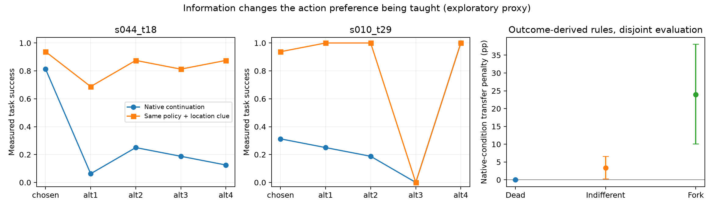

# 重新思考 OPSD：额外信息应帮助判断信用，而不能偷换信用的条件

2026-10-29。探索性研究备忘录。新增 CPU 分析已运行；没有教师推理、新续跑或训练。
原始数据、冻结标签与旧报告未改。本文提出研究假说，不将代理决策规则冒充真实 Hindsight Teacher。

## 1. 我修正的判断

之前讨论过早接受了“普通 Hindsight Teacher 已经是正确起点，只需稀疏 Q 校正”的框架。
于是原实验被分别用来给路由、候选选择、收缩和 KL 设计提供理由，科学主线反而被模块掩盖。

更值得先回答的问题是：**额外信息给 Teacher 带来的究竟是对 Student 决策后果的判断依据，
还是一个与 Student 不同的信息条件？二者是否产生不同的动作偏好？**

本项目最有潜力的连接点不是“更多信息更好”，而是：

> 信息能够帮助观察动作信用，也能够改变动作信用。教学必须保留被评价者实际拥有的信息条件。

这不是新发现了部分可观测性，也不是证明所有 Hindsight OPSD 有害。
可争取的贡献是：在真实 LLM Agent 分支中测量这一差别，解释它集中在什么信用结构中，
并验证一种更简单的证据组织是否能改善真实监督。

## 2. 为什么这是原研究的延伸

### 三域描述的是有条件的动作结果结构

固定策略、记忆、剩余预算和候选动作，测量 q(a)。改变未来可用信息，q 向量就可能改变。
因此“原 Student 的 Fork”和“获得额外线索后的弱差异”可以发生在同一物理前缀上。
未检出差异不等于真零，也不能把三域当成永久训练标签。

### Phase 3 与后续分析已经指向动作—信息对应

- G 的状态成功信息与 W1 的动作分支信息回答不同问题。
- 在旧 Live 点中，按各臂反馈是否提及目标分组，与约 60.2% 的长期动作方差对齐；
  同组大小随机分组的期望份额为 22.7%。这是关联结构，不是纯因果解释率。
- 保留动作—反馈对应，相对仅置换替代对应，在 Gold unbiased 层有 +5.63 pp 的一次动作选择增量。
- Masked 显示 chosen 的一个标量评价不能表达全部替代偏好。

这些结果共同要求保留“哪个动作使谁获得什么信息”，而非把所有事实合并成一个更长的上下文。
出处：[原裁决深化报告](final_ruling_deepening_2026-10-27.md)。

### 信息干预把这条线推进到教学条件

信息型动作对补齐同一真实线索后，原差距显著缩小。五臂干预进一步发现：
有时差距缩小，有时只剩执行障碍而动作方差反而上升。
这意味着增加信息可以改变原先值得学习的偏好，而不只是提高所有动作相同的成功率。

## 3. 本次新运行：在补信息条件下形成的偏好，能否移回原条件？

### 输入和方法

- 24 个不同任务，旧 Dead / Indifferent / Fork 各 8 点。
- 原五臂 × native/completed × 16 次，共 3,840 条已存在的实际续跑。
- 逐条读取原始 JSON，核对运行指纹、条件、任务、非 dry 状态和成功结果，
  与 `summary_blocks.csv` 的全部结果一致。
- 每点将重复编号拆为 8 次构造、8 次评价；同一编号的两个条件和所有动作放在同一侧。
- 从构造侧分别得到 q_native、q_completed，用相同 softmax(q/0.2) 形成两个选动作规则。
- 两个规则都在另一侧的 native 和 completed 条件评价。
- 256 个随机划分、双向交叉评价在点内求平均；有效任务数仍是 24，不是数千。
- 按任务 bootstrap 5,000 次。额外报告温度 0.1、0.5 和并列均分的 argmax，不按表现挑温度。

这不是 Teacher 输出，也没有更新模型。它只测试从不同信息条件得到的价值偏好是否可迁移。

### 主结果：原 Fork 的 8 个任务

| 形成动作偏好的依据 | 在原信息条件续跑 | 在补齐信息条件续跑 |
|---|---:|---:|
| 原信息条件下的回放成功率 | **66.33%** | 80.85% |
| 补信息条件下的回放成功率 | **42.38%** | 81.66% |

在原条件下，前者比后者高 **23.94 pp [10.13, 38.08]**。
在补信息条件下，后者只高 **0.81 pp [-2.62, 4.18]**，未确立明显优势。
原条件均匀选动作是 39.53%；不能说补信息规则已被证明比均匀更差。

两个规则分给“原本反馈就显示线索的动作”的平均概率，从 65.34% 降到 20.07%。
即获得共同线索后，从这些回放结果中提取的偏好不再强烈区分能自然提供线索的动作。

按温度 0.1 / 0.5，原条件迁移损失分别为 29.87 / 10.06 pp；argmax 为
32.03 pp [14.15, 48.18]。因此现象不只发生在一个 softmax 温度。

其余分层的主规则迁移损失：Indifferent 3.34 pp [0.28, 6.60]；Dead 0 pp。
三域均衡样本总体为 9.10 pp [3.40, 16.15]，不能作为自然总体平均。

7/8 个 Fork 点为正；反例 `s019_t09` 为 -6.35 pp。该点的新 native 回放本来就未明显复现旧分叉。
完整结果保留，没有根据新结果删点。

### 一个最清楚的原始案例

`s010_t29`：把雕像放到梳妆台，雕像在 shelf 1。

| 动作 | 原条件成功率 | 补齐线索后 |
|---|---:|---:|
| go to drawer 1（chosen） | 31.25% | 93.75% |
| examine dresser 1 | 25.00% | 100.00% |
| look | 18.75% | 100.00% |
| take pencil 1 from dresser 1 | 0.00% | 0.00% |
| go to shelf 1 | 100.00% | 100.00% |

原条件下，直接到 shelf 的动作具有明显优势。补信息后，四条分支都容易成功，拿铅笔的分支仍失败。
如果把后一条件得到的“四个动作都可以”移回原条件，就会丢掉 Student 尚且需要的搜索方向。
交叉评价下，该点原规则 93.22%，补信息规则 44.67%，差 48.56 pp。

这里整体 C 反而上升，因此只检查 Fork 标签或方差大小，还不足以检查教学偏好是否对齐。

### 最重要的边界

**completed 是动作执行后给 continuation 补线索；Hindsight Teacher 是评分前看到轨迹。
这两个干预不同，不能令 p_H = softmax(q_completed)。**

例如，真实 Teacher 知道雕像在 shelf 后，完全可能仍优先建议直接去 shelf，恰好符合 native 偏好。
现有新分析不能排除这一点，不能声称已经发现 Hindsight OPSD 性能下降。
它建立的是一个需要直接检查的风险：信息条件改变时，长期动作价值与可接受动作集合会改变。

另外，这些是线索富集的 8 个 Fork 任务。结果大小不能外推到全部 Fork、其他模型或其他环境。

## 4. 一个简洁的数学对象

令 d(a)=q_completed(a)-q_native(a)，均匀候选均值为 bar q，A(a)=q(a)-bar q。

\[
A_{completed}(a)-A_{native}(a)=d(a)-\bar d.
\]

这是恒等式，不是新理论。它把两个不同问题分开：

- bar d：额外信息是否让任务更容易成功；
- d(a)-bar d：额外信息是否改变了应该偏好哪些动作。

若 d 在所有动作上相同，信息提高成功率却不改变该参考下的动作偏好。
若 d 主要补救原来没有获得线索的动作，原先获取信息的动作优势就可能被削弱。
若另有只在某个分支出现的执行限制，信息还可能改变偏好的主要来源。

因此可以提出、但尚未证实的 OPSD 假说是：

> 信息型关键点可能恰好最容易出现特权条件与学生条件的信用错配；
> Teacher 的知情程度和其监督对学生的适用性，应当分别测量。

这比笼统说“教师有时会错”更具体：它预测错配集中在哪里、偏好会怎样变化，
并允许真实 Teacher 通过正确的条件推理避免错配。

## 5. 方法先减到一个可检验的原则

**Teacher 可以获得额外证据，但应评价 Student 在原有信息条件下执行动作的后果。**

第一原型可以只改变 Teacher 的证据组织，保留标准 token OPSD：

1. Student 产生原轨迹、回复与 token 前缀。
2. 训练时取得少量候选的一步反馈；以明确的动作—响应对应，标注为待评估的分支证据。
3. Teacher 在同一 Student token 前缀上提供分布；Student 输入仍是原可见历史。

关键呈现内容不是“现在你已经知道目标在哪里”，而是“动作 a 会让原 Student 收到反馈 o_a；
未执行分支的反馈不会进入 Student 的记忆”。Factual hindsight 的表示应在对照中固定。

这一实现仍是假说：结构化表述不保证模型正确区分自己的知识与学生的知识，
也不保证局部响应足以预测执行瓶颈。Teacher 的建议可能依赖无法从 Student 输入推断的隐藏事实，
需要后续无特权策略评估，不能用 prompt 指令消除这个问题。

先不把路由器、Beta 收缩、三臂 Q、指数校正和混合 KL 全部设为核心方法。
原生回放首先充当测量标尺；如果只改变证据组织不能产生有效监督，再依据失败模式决定
是否需要少量 Student continuation。不能为了简洁而预先宣布回放无用。

## 6. 最值得先做的一个实验：真实 Teacher 是否出现这个错配？

只做真实 Teacher 评分，不训练、不新增完整续跑。用这 24 个机制点做开发性检验，
再用已准备、按任务隔离的历史样本核验有效规则。

固定 checkpoint、Student 原 prompt、实际思考前缀、候选命令和完整 Hindsight 表示，比较：

| 条件 | 变化 |
|---|---|
| H | 普通完整轨迹 Hindsight |
| H + aligned W1 | 加入与动作正确对应的一步分支证据，说明 Student 只会得到所选分支反馈 |
| H + shuffled W1 | 同样内容与说明，仅错配未选动作的对应关系 |

Teacher 不读取回放 q 或旧标签，不要求它输出自报数值 Q。用完整候选命令序列 log probability
读取其实际相对动作偏好；后续训练仍可采用同一条件下的标准全词表 token KL。

主读出为同一 Teacher 偏好在 native 与 completed 两种已有独立结果中的价值，
以及对能自然提供线索动作的概率分配。Teacher 不使用这些结果构造或调参，
测得的是候选集内的一次建议价值，不是自由生成动作边际或端到端性能。

有区分力的结果包括：

- H 已匹配 native、aligned 无增量：停止“hindsight 导致此类错配”的强故事；保留信息机制论文。
- H 的建议更适合 completed，而 aligned 对 native 的收益提高、shuffled 不提高：
  支持证据的条件关系影响教学适用性，才进入小规模标准 token OPSD。
- aligned/shuffled 同样提高：更多内容、提示形式或其他因素更有可能解释收益，不能主张对应结构。
- 所有 Teacher 都无法形成 native 有效建议：真实 Student 回放可能确有必要；此时稀疏校正成为
  有明确失败原因的补救，而不是先拼出的一整套算法。

本实验只需教师前向评分。开销主要是长上下文 prefill，应先记录单点耗时；本轮未运行，
不再套用过去完整续跑的 1.7 秒吞吐来承诺成本。

## 7. 文献边界与研究判断

不能把“特权专家未必适合部分可观测学生”当作新理论。
[Cai et al., Provable Partially Observable RL with Privileged Information](https://arxiv.org/html/2412.00985v2)
已给出专家蒸馏可能次优的条件与反例。其问题覆盖观测混叠等情形，不等同于本文实测的线索干预。

[IGSD](https://arxiv.org/abs/2609.32694) 已在 Search Agent 中用配对执行的检索反馈验证
Hindsight 指导，并将信息增益用于候选对蒸馏。因此“给 Teacher 增加环境验证”本身也不够新。

可以争取的新证据链是：**信用结构 → 分支信息的作用 → 改变信息后的偏好迁移代价 →
实际 Teacher 是否保留 Student 的决策条件 → 一个简洁的监督构造及学习收益。**

在 Teacher 结果出来之前，最稳妥的核心仍是“不同信息条件的动作信用不能直接混用”；
最有潜力的升级是“增加教师信息，可能在信息型关键点抹去学生最需要学习的动作区别”。
后一句现在明确是待验证假说，不应提前作为论文结论。

脚本与全部结果：[分析目录](../exploratory_deep_discovery/teaching_information_2026_10_29/README.md)。
